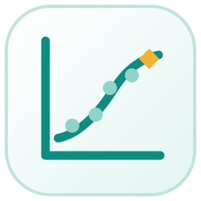
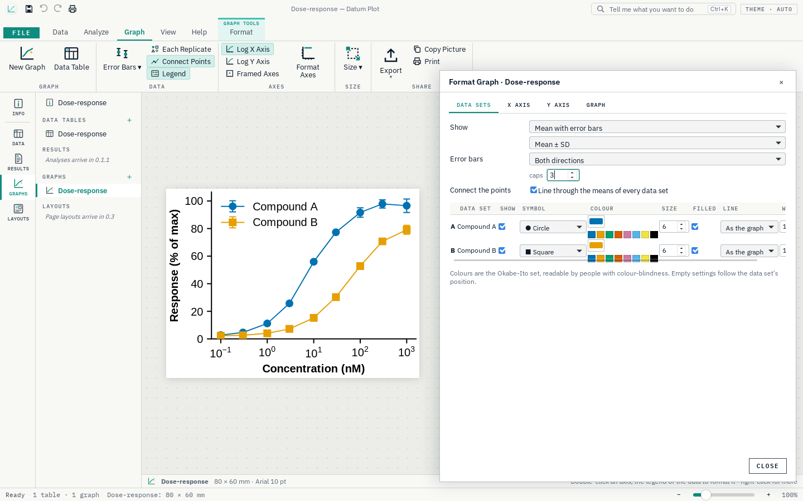
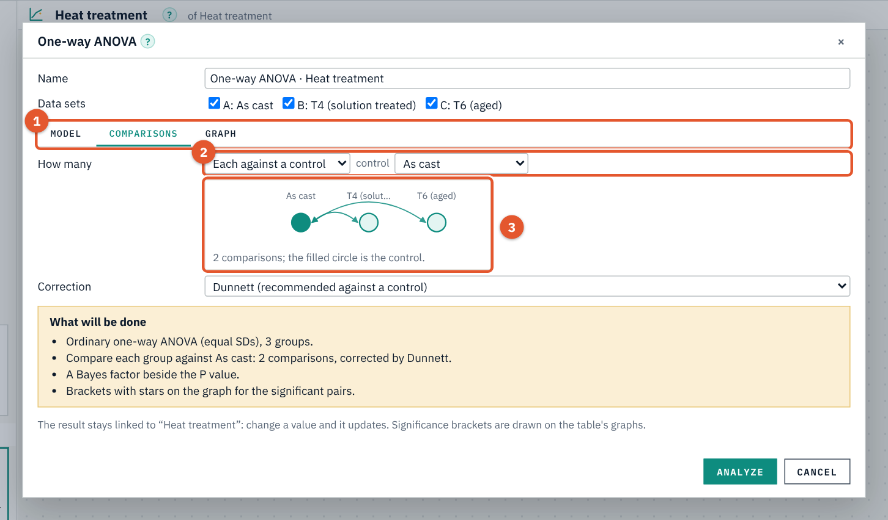

<div align="center">



# Datum Plot

**Scientific graphs, statistics and curve fitting.**

[](https://github.com/Edgar-Mendonca/Datum-Plot/releases/latest)
[](https://github.com/Edgar-Mendonca/Datum-Plot/actions/workflows/ci.yml)
[](https://github.com/Edgar-Mendonca/Datum-Plot/releases)
[](LICENSE)
[](https://github.com/Edgar-Mendonca/Datum-Plot/releases/latest)
[](crates/core)
[](py)
[](https://tauri.app)
[](ui/src)

[](https://github.com/Edgar-Mendonca/Datum-Plot/releases/latest)
[](CHANGELOG.md)
[](https://github.com/Edgar-Mendonca/Datum-Plot/issues/new)
[](docs/MEMORY.md)

</div>



## What it does

Datum Plot is part of Datum; see its page: https://edgar-mendonca.github.io/Datum/apps/plot

Datum Plot keeps a project as a chain: **data tables → analyses → results → graphs → layouts**. Everything stays linked, so changing a value updates every result and graph that uses it.



### Data
- **Tables for every kind of experiment**: XY, column (one group per column), grouped (two factors), contingency (counts), survival, nested and multiple-variable tables. Replicates or a mean with SD or SEM and N; dates and times in the X column, drawn on date axes. Paste from a spreadsheet, fill series, exclude a value without deleting it.
- **Worksheets** with free columns, units and comments, and **column formulas** such as `log10(A)` or `(B - mean(B)) / sd(B)` that update as the data change.
- **Import** CSV, TXT, .xlsx and .pzfx files, 96- and 384-well plates and many runs at once. Large data sets (hundreds of thousands of points) stay quick.
- **Graph digitizer**: read the points of a published graph from its picture into a table.

### Analysis
- **Statistics**: descriptive statistics, normality, outliers, t-tests, nonparametric tests, one-, two- and three-way ANOVA with multiple comparisons, repeated measures and mixed-effects models, ANCOVA, **Bayes factors** beside the P values, multiple t-tests with false discovery rates and volcano plots, nested t-tests and ANOVA, contingency tables, correlation, power, Bland-Altman, ROC, agreement (Cohen's kappa, McNemar), bootstrap confidence intervals and survival analysis (Kaplan-Meier, log-rank, hazard ratios).
- **Regression and curve fitting**: linear regression (fit ranges, Deming, comparing lines), a model library or your own equation, global fits and model comparison, smoothing splines, area under the curve; multiple, logistic and Poisson regression, principal components and clustering.
- **IC50 and EC50**: dose-response curves with normalising, pIC50, confidence intervals and a test of whether compounds differ.
- **Matrices and 3D**: contour maps, heat maps, 3D surfaces, 3D scatter and vector fields; surface fits (plane, quadratic, cubic, 2D Gaussian).
- **Peaks and signals**: find peaks above a baseline, fit Gaussian, Lorentzian or Voigt peaks, Fourier spectra and filters, wavelet scalograms and spectrograms.
- **Quality**: control charts (individuals, X̄–R, X̄–S, p) with capability, and two-level factorial designs with their effects.
- **Materials testing**: tensile tests, Weibull strength, Arrhenius activation energies, S–N fatigue curves, and DSC/TGA thermal analysis (onsets, enthalpies, mass loss).
- **Choosing an analysis**: the **Analyze Data** window has a search box, lists the analyses that suit your table first (and those you used recently), lets you tick the data sets, and explains each analysis. Long option windows are in tabs.
- **Multiple comparisons, made clear**: after one- or two-way ANOVA, compare the data sets within each row, the rows within each data set (across rows), every cell, or the main effects; every pair, each against a control, or only the pairs you choose. A small picture of your table shows exactly which means are compared. Corrections: Tukey, Dunnett, Šidák, Holm-Šidák, Bonferroni, the false discovery rate, or none.
- **What will be done**: the ANOVA windows say in plain words what will be run before you press Analyze; with repeated measures a picture shows which values belong to one subject. Residual plots (residuals, spread, normal QQ) check the model.
- Every result stays linked to its data, explains itself in plain words and gives ready **methods text**.

### Graphs
- **Publication-quality graphs** drawn with matplotlib: XY, column graphs (dots, bars, box plots, violins), grouped bars, box plots and violins, pie and donut charts, forest plots, polar, ternary, bubble, radar and waterfall graphs.
- **Box plots** with whiskers from the minimum to the maximum, Tukey (1.5 × IQR) or percentiles.
- **Significance brackets and stars** that stay readable however many there are, chosen per graph, including brackets across the rows of a grouped graph.
- **Styling**: error bars (mean or median; SD, SEM, 95% CI or range), colour-blind-safe colour schemes, symbols, fills and **fill patterns** (stripes, cross-hatching, dots and more, with their own strength and thickness), axis breaks, a second Y axis, label angles, text sizes, titles and subtitles, annotations and insets. Save **your own style** for every new graph.
- **Interactive**: hover a point to see its value and where it is in the table, zoom, pan, drag notes, exclude points with a right-click, and the statistics of any region.
- **Page layouts** at journal sizes, multi-panel figures, posters and slides.
- **A tidy project**: drag items into your own order and folders, colour them, show one table's family (its results and graphs) only; renaming a table renames its graphs and results.

### Export and share
- PNG or TIFF at any dpi (with CMYK), or SVG, PDF and EPS with editable text.
- Every graph as slides (.pptx or .odp), or a document with graphs, results and methods (.docx or .odt); tables and results as a workbook (.xlsx or .ods). Print with headers, footers and captions.
- Graphs pasted into documents, slides and workbooks open again in Datum Plot with a double-click (Windows).

### Also inside
- A **Python console** (below), your own saved analyses, analysis templates, batch processing and notebook export.
- A step-by-step **guide** with pictures in English, Chinese and French (Help › Guide), and over twenty sample projects grouped by subject.
- **Safe and sturdy**: projects never run code, saves never leave half-written files, damaged files open or explain why, and updates are checked against their checksums.

Everything stays on your computer. The only network call is the update check to GitHub.

### Coming next
- Testers' requests from GitHub issues come first, released in small steps.
- **Modules**: science, engineering and quality tools you can switch on (being planned).
- **1.0 Stable**: a signed installer and a validation report against reference values.
- Mac and Linux versions are on hold for now. The full plan is in the [roadmap](docs/MEMORY.md#3-roadmap).

## Install

Download `DatumPlot-x.y.z-setup.exe` from [Releases](https://github.com/Edgar-Mendonca/Datum-Plot/releases/latest) and run it. It installs for your user account in seconds, with its own Python (nothing else to install), and updates itself from the Home page. Windows 10 and 11.

## The Python console

Tools › **Python Console** runs your own Python on the project's data, inside the app (nothing else to install):

1. **Write** code in the box at the top. Your tables are ready as pandas DataFrames: `tables` lists them, `table(0)` is the first, `tables['Name']` one by its name. Columns are named after the data sets (replicates as `Control 1`, `Control 2`), X first.
2. **Run** it with ▶ Run or **Ctrl+Enter**. What you `print`, the value of the last line and any `plt` figure appear underneath; an error names the line.
3. **Keep going**: variables last between runs (Reset clears them). `np`, `pd`, `stats` (scipy.stats), `scipy` and `plt` are ready.
4. **Put results back**: `new_table('Name', data)` adds a table to the project; `result('Analysis name')` gives an analysis's numbers.
5. **Save** code you reuse with Save As My Analysis, and run it again from Tools › My Analyses.

```python
df = table(0)
fit = stats.linregress(df.iloc[:, 0], df.iloc[:, 1])
print(f"slope {fit.slope:.4g}, R² {fit.rvalue**2:.4f}")
new_table("Log values", {"X": df.iloc[:, 0], "log10 Y": np.log10(df.iloc[:, 1])})
```

The ⓘ How to use button in the console and the ? beside it in the ribbon show the same guide. Code runs only when you press Run; projects never contain code, so opening someone else's project never runs anything.

## How to cite

If Datum Plot helped your work, please cite it with the version you used (File › Updates shows it):

> Mendonca, E. (2026). *Datum Plot* (Version 0.4.33) [Computer software]. https://github.com/Edgar-Mendonca/Datum-Plot

```bibtex
@software{datum_plot,
  author  = {Mendonca, Edgar},
  title   = {Datum Plot},
  version = {0.4.33},
  year    = {2026},
  url     = {https://github.com/Edgar-Mendonca/Datum-Plot},
  license = {MIT}
}
```

GitHub's **Cite this repository** button (from [CITATION.cff](CITATION.cff)) gives the same in APA and BibTeX. Every result's **methods text** already names Datum Plot and the Python library behind the calculation (for example SciPy or statsmodels); cite those too if your journal asks for it.

## Build

Rust (stable), Node 22 and Python 3.13 with `pip install -r py/requirements.txt`:

```
npm ci
npm run build:ui
cargo run -p datum-plot          # the app, using the Python on your PATH (or DATUM_PYTHON)
cargo test --workspace && npm run test:py && npm run test:ui
```

Datum Plot is the second app of the Datum family, after [Datum Plan](https://github.com/Edgar-Mendonca/Datum-Plan). MIT licence; third-party notices in [NOTICE](NOTICE).

Product and file-format names are trademarks of their owners and are used only to describe file compatibility.
