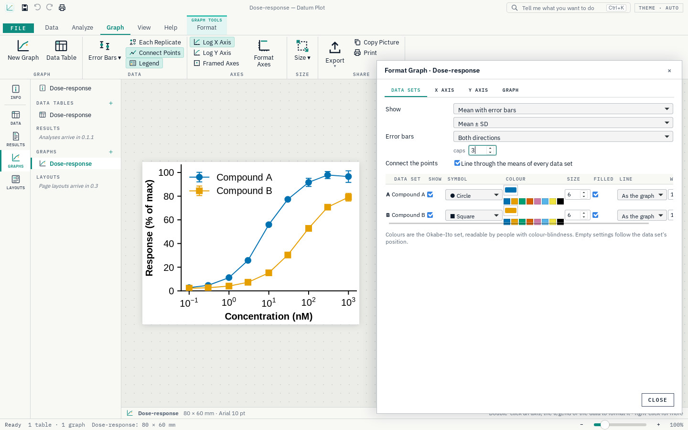

<div align="center">


# Datum Plot

**Scientific graphs, statistics and curve fitting: one app for Windows.**

[](https://github.com/Edgar-Mendonca/Datum-Plot/releases/latest)
[](https://github.com/Edgar-Mendonca/Datum-Plot/actions/workflows/ci.yml)
[](https://github.com/Edgar-Mendonca/Datum-Plot/releases)
[](LICENSE)
[](https://github.com/Edgar-Mendonca/Datum-Plot/releases/latest)
[](crates/core)
[](py)
[](https://tauri.app)
[](ui/src)

[](https://github.com/Edgar-Mendonca/Datum-Plot/releases/latest)
[](CHANGELOG.md)
[](https://github.com/Edgar-Mendonca/Datum-Plot/issues/new)
[](docs/MEMORY.md)

</div>



## What it does

Datum Plot keeps a project as a chain: **data tables → analyses → results → graphs → layouts**. Everything stays linked, so changing a value redraws its graphs.

- **Data tables** that work like Excel: an X column and data sets with replicates, or a mean with SD or SEM and N. Paste from Excel, fill series, exclude a value without deleting it.
- **Publication-quality graphs** drawn with matplotlib: means with SD, SEM, 95% CI or range, linear or log axes, colour-blind-safe colours, sizes in millimetres for journal columns.
- **Export** as PNG or TIFF at any dpi, or as SVG, PDF and EPS with editable text. Copy into Word or PowerPoint. Print with headers, footers and captions.
- **Statistics and curve fitting** arrive release by release on the built-in Python engine (numpy, SciPy): column statistics in 0.1.1, t-tests, ANOVA and nonlinear regression in 0.2.0. See the [roadmap](docs/MEMORY.md#3-roadmap).

Everything stays on your computer. The only network call is the update check to GitHub.

## Install

Download `DatumPlot-x.y.z-setup.exe` from [Releases](https://github.com/Edgar-Mendonca/Datum-Plot/releases/latest) and run it. It installs for your user account, with its own Python, and updates itself from the Home page.

## Build

Rust (stable), Node 22 and Python 3.13 with `pip install -r py/requirements.txt`:

```
npm ci
npm run build:ui
cargo run -p datum-plot          # the app, using the Python on your PATH (or DATUM_PYTHON)
cargo test --workspace && npm run test:py && npm run test:ui
```

Datum Plot is the second app of the Datum family, after [Datum Plan](https://github.com/Edgar-Mendonca/Datum-Plan). MIT licence; third-party notices in [NOTICE](NOTICE).
