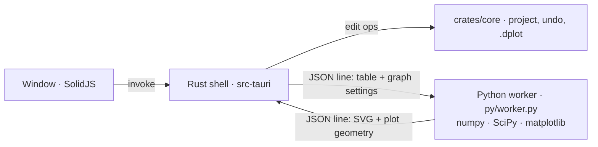

# Datum Plot 0.1: brainstorm, comparison and release plan

Status: **answered and built as 0.1.0.** The user approved the plan, icon and colours, asked to see the app before answering the detailed questions, and decided that **Python is built in** (see §9, which replaces the engine parts of §3).


**Goal:** a small, fast Windows app for scientific graphs, statistics and curve fitting. It takes the guided, "pick the right test and get a publication graph" way of working from **GraphPad Prism**, and the open workbook, many graph types and analysis power of **OriginPro**. It is the second app in the Datum family, so it looks, feels and ships like Datum Plan ([FAMILY.md](https://github.com/Edgar-Mendonca/Datum-Plan/blob/HEAD/docs/FAMILY.md)): teal accent, `.dplot` files, `com.edgarmendonca.datumplot`, releases and updates from `Edgar-Mendonca/Datum-Plot`.

This file follows the family pattern: what the tools do → what we take → proposal → release plan → size → questions.

---

## 1. How the two tools think

| | GraphPad Prism | OriginPro |
| --- | --- | --- |
| **Who uses it** | Biologists, pharmacologists, medical researchers. People who need the right test and a clean graph, not programming. | Physicists, chemists, engineers, materials science. People with large instrument data, spectra and many curves. |
| **Core idea** | A project is a chain: **data table → analysis → results → graph → layout**. The table *type* decides which analyses and graphs make sense. Everything stays linked: edit a value and every result and graph updates. | A project is a folder of **workbooks** (free spreadsheets with column roles X, Y, Z, error), **matrices**, **graphs** and **notes**. You pick columns and plot or analyse anything. Analyses can recalculate automatically or on request. |
| **Strength** | Guidance: the table type, the "which test?" dialogs, analysis checklists, plain-language results ("P < 0.05, significant"), asterisk brackets. A huge built-in curve library with dose-response, binding and kinetics. | Breadth: 100+ graph types (3D, contour, polar, ternary, waterfall, multi-panel), layers, insets, double Y, peak analysis, signal processing, batch processing, scripting (LabTalk, Origin C, Python). |
| **Weakness** | Limited graph types, rigid tables, little signal or spectral analysis, no scripting, Windows/Mac only, expensive yearly licence. | Steep learning curve, dense dialogs, dated look, statistics are less guided, expensive, Windows only. |
| **Files** | `.prism` (new, zip), `.pzfx` (XML, open, documented enough to import). | `.opju` / `.opj` (closed binary). |

**Datum Plot's place:** Prism's linked, guided chain as the backbone (every table, analysis and graph is a live object in one navigator), with Origin's freedom where it matters (any columns of any table can be plotted, several layers, many graph types, peaks and signals later). The look is the Datum family's: ribbon, square controls, IBM Plex, a clean light theme.

---

## 2. Feature comparison

✓ full · ◐ partial · — none. The last column is when Datum Plot gets it (see §6).

### 2.1 Data tables

| Table | Prism | Origin | What it holds | Datum Plot |
| --- | --- | --- | --- | --- |
| **XY** | ✓ X + many Y data sets, each with replicates or entered mean/SD/SEM/N, X error, row titles | ✓ any worksheet with X/Y/yEr column roles | Dose-response, time courses, calibration curves, spectra | **0.1.0** |
| **Column** | ✓ one group per column, replicates down; or mean/SD/N entry | ◐ plain columns (long or wide) | Compare groups: t-tests, one-way ANOVA | 0.1.1 |
| **Grouped** | ✓ rows × data sets with side-by-side replicates | ◐ by arranging columns | Two factors: two-way ANOVA, grouped bars | 0.3.0 |
| **Contingency** | ✓ counts in rows × columns | ◐ cross-tabulation tool | Chi-square, Fisher's exact, odds ratio, relative risk | 0.3.0 |
| **Survival** | ✓ X = time, Y = 1 (event) / 0 (censored) per group | ✓ survival tools on columns | Kaplan-Meier, log-rank, hazard ratio | 0.4.0 |
| **Nested** | ✓ subcolumns grouped under columns (e.g. cells within mice) | — | Nested t-test, nested one-way ANOVA | 0.4.0 |
| **Parts of whole** | ✓ | ✓ | Pie, donut, stacked 100 % | 0.3.0 |
| **Multiple variables** | ✓ one row per subject, many variables (incl. text) | ✓ (it is a worksheet) | Multiple/logistic regression, correlation matrix, PCA | 0.4.0 |
| **Matrix (Z grid)** | — | ✓ matrix books | Heat maps, contour, 3D surfaces | 0.5.0 |
| **Free worksheet** | — | ✓ column roles, formulas, metadata (long name, units, comments), sparklines | Raw data, import, anything that does not fit a type | 0.5.0 |

Common to all tables (from both tools, built once in the shared grid engine):
- Excel-like grid with ranges, TSV clipboard, fill series, Paste Special, formatting (family `selection.ts`, `cells.ts`, `fmt.ts`).
- Column title, **units** and a comment per column (Origin's long name/units/comments). A table title and notes.
- **Exclude** a value without deleting it (Prism shows it blue and italic; analyses and graphs skip it).
- Row titles. Sub-columns for replicates. Entry formats (raw replicates, mean + SD + N, mean + SEM + N, mean + CV, upper/lower limits).
- Later: column formulas in Excel syntax through GridCraft (Origin's "Set Column Values"), transforms (log, normalise, baseline-subtract, remove baseline) that make a new linked table, as Prism does.

### 2.2 Analyses

| Area | Prism | Origin | Datum Plot |
| --- | --- | --- | --- |
| **Descriptive** | Column statistics: N, mean, SD, SEM, 95 % CI, median, quartiles, min/max, CV, geometric mean, skewness, kurtosis | Same plus more moments, percentiles, frequency counts | 0.1.1 |
| **Normality and outliers** | D'Agostino-Pearson, Anderson-Darling, Shapiro-Wilk, Kolmogorov-Smirnov; QQ plot; ROUT and Grubbs outliers | Shapiro-Wilk, KS, Lilliefors, Anderson-Darling, D'Agostino, Chen-Shapiro; Grubbs, Dixon Q | 0.1.1 (Shapiro-Wilk, D'Agostino, QQ); ROUT 0.2.0 |
| **t-tests** | Unpaired (Student, Welch), paired, ratio paired, one-sample; multiple t-tests with FDR (Benjamini-Hochberg, Two-stage) | One/two-sample, paired; also t-test on summary data | 0.2.0 |
| **Nonparametric** | Mann-Whitney, Wilcoxon signed-rank, Kolmogorov-Smirnov, Kruskal-Wallis + Dunn, Friedman + Dunn | Same set plus Mood's median, sign test, Cochran Q | 0.2.0 |
| **One-way ANOVA** | Ordinary, Welch, Brown-Forsythe, repeated measures (with Geisser-Greenhouse), mixed model for missing values | Ordinary, RM, Welch; homogeneity tests (Levene, Brown-Forsythe) | 0.2.0 |
| **Multiple comparisons** | Tukey, Dunnett, Šidák, Bonferroni, Holm-Šidák, Fisher LSD, Dunn; test for trend; summary asterisks; adjusted P | Tukey, Bonferroni, Šidák, Scheffé, Dunnett, Fisher, Holm-Bonferroni, Holm-Šidák | 0.2.0 |
| **Two-/three-way ANOVA** | Ordinary, RM in one or both factors, mixed model; three-way | Two-way, three-way, RM | 0.3.0 (two-way); three-way later |
| **Correlation** | Pearson, Spearman, correlation matrix, partial correlation | Pearson, Spearman, Kendall, partial | 0.3.0 |
| **Linear regression** | Slope/intercept with CIs, R², runs test, compare slopes and intercepts, force through origin, Deming (errors in X and Y), confidence and prediction bands, interpolation | Linear, polynomial, multiple linear, with full ANOVA table; fit with errors as weights | 0.2.0 |
| **Nonlinear regression (curve fitting)** | ~100 built-in models in families (dose-response stimulation/inhibition with 3/4/5 parameters, Hill, binding saturation and competition, enzyme kinetics: Michaelis-Menten, substrate inhibition, allosteric; exponential growth/decay one/two phase, plateau; Gaussian, Lorentzian, sine, polynomials, sigmoidal); user equations; constraints and shared parameters (**global fitting**); weighting (1/Y², relative, Poisson); robust fit; ROUT outlier removal; compare models (extra sum-of-squares F test, AICc); compare a parameter between data sets; interpolate unknowns from a standard curve; residual plots; CIs by asymptotic or profile likelihood | NLFit with 200+ functions in categories, user functions (incl. implicit and surface fits), parameter sharing across data sets, fixing, bounds, weighting by error columns, batch fitting, fit comparison (F test, AIC), simulation, reports with residual plots | 0.2.0 (engine + 20 models); 0.2.1 (global fitting, compare models, interpolation, ~60 models) |
| **Survival** | Kaplan-Meier with censoring marks, log-rank (Mantel-Cox), Gehan-Breslow-Wilcoxon, test for trend, median survival, hazard ratio (Mantel-Haenszel and log-rank), Cox proportional hazards regression | Kaplan-Meier, Cox, Weibull fit | 0.4.0 |
| **Contingency** | Chi-square (with Yates), Fisher's exact, relative risk, odds ratio, sensitivity/specificity, chi-square for trend | Chi-square, Fisher's exact, McNemar | 0.3.0 |
| **Other Prism analyses** | Area under curve, ROC curves, Bland-Altman, frequency distribution, normalise/transform/baseline, smoothing, derivative, integral, multiple and logistic regression, PCA, Hill plots | — | AUC, frequency distribution, transforms 0.1.1–0.2.0; ROC and Bland-Altman 0.3.0; multiple/logistic regression and PCA 0.4.0 |
| **Origin-only power** | — | Peak Analyzer (baseline, find, integrate, fit many peaks), FFT, filters, smoothing (Savitzky-Golay, LOWESS), interpolation, integration, differentiation, cluster analysis, discriminant, PLS, batch processing with analysis templates, Gadgets (quick fit on a region of interest), scripting | 0.5.0 (peaks, smoothing, FFT, ROI gadgets); batch 0.6.0 |
| **Help to choose** | "Which test?" guides, analysis checklists, interpretation text | Minimal | 0.2.0: test chooser + Explain panel (see §4) |

### 2.3 Graphs

| Area | Prism | Origin | Datum Plot |
| --- | --- | --- | --- |
| **XY** | Points, connected lines, mean ± error bars, every replicate, fitted curves with bands, spline | Line, scatter, line + symbol, spline, step, drop lines, error bars from columns, fill area | **0.1.0** (points, lines, mean ± error bars, replicates); curves 0.2.0 |
| **Column graphs** | Scatter dot plot with mean/median lines, bars with error bars, box and whiskers (Tukey, min-max, percentiles), violin (truncated or smooth), before-after, estimation plots | Column/bar, box, violin, half-box + points, beeswarm, interval plots | 0.1.1 |
| **Grouped** | Interleaved, separated and stacked bars, grouped scatter, heat map | Grouped columns, stacked, floating | 0.3.0 |
| **Distribution** | Frequency histogram, cumulative, QQ plot | Histograms with fitted distribution, probability plots, Pareto | 0.1.1 (QQ, histogram) |
| **Survival** | Staircase curves with censor ticks, at-risk table | Staircase | 0.4.0 |
| **Special** | Volcano, bubble, Bland-Altman, forest (via grouped), pie/donut, parts of whole | Polar, ternary, Smith chart, waterfall, 3D (scatter, surface, bars), contour, heat map, vector, windrose, radar | heat map, pie 0.3.0; volcano, forest 0.4.0; contour, 3D surface, polar, waterfall, ternary 0.5.0 |
| **Axes** | Linear, log (10, 2, ln), probability, axis breaks/gaps (two segments), reverse, frame/offset axes, custom ticks, minor ticks | Same plus double Y, top/right axes, layer-linked axes, many scale types, broken axes with several breaks | 0.1.0 linear + log10, ranges, ticks; breaks and double Y 0.3.0 |
| **Styling** | Format Graph dialog, Magic (copy the look of another graph), graph families, colour schemes, themes; drawing tools, text, lines | Plot Details (deep), themes, graph templates, Copy/Paste Format, layers, insets, multi-panel templates (stack, 4-panel, 9-panel), linked layers | 0.1.0 Format Graph (data sets, axes, size); styles + "Copy look" 0.2.0; layers/insets/multi-panel 0.5.0 |
| **Error bars** | SD, SEM, 95 % CI, range; one direction or both; caps; from entered mean/SD; X error | From columns (yEr, xEr), plus/minus separately, as band | **0.1.0** SD, SEM, 95 % CI, range |
| **Statistics annotations** | Pairwise comparison brackets with asterisks or P values placed automatically from the analysis, the "ns" text, P-value style (GP: 0.1234 (ns), 0.0332 (*), 0.0021 (**), 0.0002 (***), <0.0001 (****)) | Manual with drawing tools; some apps add brackets | 0.2.0 (linked to the analysis, update when data change) |
| **Size and fonts** | Exact size in cm/in, font for the whole graph, journal-friendly | Exact page size, themes | **0.1.0** size in mm, one font and size for the graph |

### 2.4 Layouts and export

| | Prism | Origin | Datum Plot |
| --- | --- | --- | --- |
| **Page layouts** | A page with arranged graphs, tables, text and pictures; labels A, B, C; alignment; linked to the live graphs | Layout pages with graphs and worksheet tables; multi-panel graphs | 0.3.0 (Layout page with grid, panel letters, live graphs) |
| **Export** | PNG, TIFF, JPEG, PDF, EPS, SVG, EMF/WMF; DPI and colour (RGB/CMYK); batch export | All of those, plus clipboard as EMF for Office, batch export | 0.1.0 SVG + PNG (300/600 dpi) + Print/PDF; TIFF, EMF clipboard 0.3.0; batch 0.6.0 |
| **Clipboard to Office** | EMF picture, embedded object | EMF, embedded | 0.1.0 PNG to clipboard; EMF later |
| **Print** | Print the graph or layout | Print | **0.1.0** File › Print with live preview (family `print.tsx`) |
| **Import** | Paste, text/CSV, Excel, `.pzfx` | Many instrument formats, Excel, CSV, binary, connectors | 0.1.0 paste from Excel; CSV/XLSX 0.1.1; `.pzfx` (Prism's open XML) 0.3.0 |

---

## 3. Architecture (same stack as Datum Plan)

```mermaid
flowchart LR
  subgraph UI["Window (WebView2) · ui/src/*.tsx → Vite → ui/dist"]
    Store[store.ts: project, open item, selection, act(op)]
    Nav[navigator.tsx: Info · Data · Results · Graphs · Layouts]
    Table[table.tsx: data grid on the family grid engine]
    Graph[graph.tsx: SVG renderer for a GraphOut scene]
    Fmt[format.tsx: Format Graph / Format Axes dialogs]
    BS[ribbon.tsx · backstage.tsx · print.tsx (from Plan)]
  end
  subgraph Shell["src-tauri (Rust)"]
    Cmd[main.rs: new · open · save · apply · item · graph · options · recovery · save_file · open_url]
    Upd[update.rs: REPO = Edgar-Mendonca/Datum-Plot]
  end
  subgraph Core["crates/core (pure Rust, unit-tested)"]
    Model[model.rs: Project · Table(kind) · Analysis · Graph · Layout]
    Doc[doc.rs: Op enum · undo/redo · .dplot]
    Stats[stats/: descriptive · distributions · tests · ANOVA]
    Fit[fit/: Levenberg-Marquardt · model library · expressions]
    Plot[plot.rs: scales, nice ticks, error bars → GraphOut]
    IO[io/: csv · xlsx · pzfx]
  end
  UI -- "invoke(cmd, args)" --> Cmd --> Doc --> Model
  Cmd --> Stats & Fit & Plot
```

**Rules (as in Plan):**
- The window never computes a statistic, a tick or an error bar. Every edit is an `Op`; the engine applies it, recomputes what depends on it and returns what the window shows.
- **Live chain:** analyses and graphs store only their *settings* and the id of their input. Results are computed when asked (cached by revision), so editing a value updates every result and graph, as in Prism. The `.dplot` file stores data and settings, never stale results.
- **Graphs:** the engine turns a graph's settings + data into a `GraphOut` scene (axis ranges, ticks and labels, points, error bar segments, lines, legend entries, all in data and mm units). The window draws it as **SVG**, so screen, print, SVG/PNG export and later PDF/EMF all come from one scene. Chart.js stays for the small Home/preview charts only, if at all (question 8.4).
- **Numbers we can trust:** every statistic is checked in a unit test against a published value: **NIST StRD** reference datasets (Norris, Longley for linear regression; Misra1a, Thurber, MGH09, Eckerle4 for nonlinear; ANOVA sets SiRstv, AtmWtAg), plus worked examples from R output. A "validation" page in the docs lists them.
- **Libraries:** `statrs` (MIT, pure Rust) for distributions (t, F, χ², normal, gamma, beta) so P values are correct; our own small Levenberg-Marquardt and QR (parameters are few, a few hundred lines) rather than `nalgebra`; GridCraft (pinned, as in Plan) for column formulas later. No Python.

**File `.dplot`:** JSON (format 1), with a `format` number and migration as in Plan. Later it can be zipped if graphs embed pictures.

**Model sketch:**
```text
Project { name, info: Info (notes, experiment fields), tables: Vec<DataTable>, analyses: Vec<Analysis>,
          graphs: Vec<Graph>, layouts: Vec<Layout>, ui }
DataTable { id, name, kind: XY | Column | Grouped | …, x: Column, sets: Vec<DataSet>, row_titles, notes }
DataSet  { title, units, entry: Replicates(n) | MeanSdN | MeanSemN | …, cells: Vec<Vec<Option<f64>>>, excluded }
Analysis { id, kind, input: TableId, sets: Vec<usize>, params: serde_json::Value }   // 0.1.1+
Graph    { id, source: TableId | AnalysisId, kind, sets: Vec<SetStyle>, axes: [Axis; 2+], size_mm, font, legend }
```

**Window layout (FAMILY §6, adapted):**
- Title bar, quick access, Tell Me (Ctrl+K), Theme, as in Plan.
- **Ribbon tabs** (proposal): File · **Data** (clipboard, font, insert rows/columns, exclude, sort, transform) · **Analyze** (Analyze…, column statistics, quick tests, fit a curve) · **Graph** (new graph, graph type gallery, change data sets) · **Format** (Graph Tools, contextual: axes, data sets, colours, size, copy look) · **Layout** · **View** · **Help**.
- **Left sidebar:** the family icon rail with **Info** first (Prism's Info sheet = Plan's Setup), then **Data**, **Results**, **Graphs**, **Layouts**. Next to it a narrow **navigator** list (Prism's) with every item of that kind, its family links (data → its results → its graphs), and right-click New/Duplicate/Rename/Delete.
- **Status bar:** Ready, selection N/Mean/SD/Sum (Plot's version of Plan's Sum/Average/Count), item type, zoom.

---

## 4. Ideas beyond Prism and Origin

1. **Explain panel** for every result: what the test asked, the answer in one sentence ("The means differ, P = 0.003"), the assumptions it checked (normality, equal variance, pairing) with ✓/⚠, and what to try if one failed. Prism has checklists; we put them next to the numbers.
2. **Test chooser:** three or four questions (how many groups? paired? normal? what do you want to know?) that open the right analysis with the right options. Starts from the table type, as in Prism.
3. **Methods text:** every analysis writes a ready-to-paste sentence for a paper's methods and figure legend ("Data are mean ± SD, n = 6. Groups were compared by one-way ANOVA with Tukey's multiple comparisons test."), with the software version.
4. **Effect sizes and CIs by default** (difference of means with 95 % CI, Cohen's d, Hedges' g, η²) and optional **estimation plots**, so results are more than a P value.
5. **Reproducible check:** "Show as R code" for each analysis, so a reviewer can verify the numbers outside the app. No R needed inside the app; it is just text.
6. **Journal presets** for graphs: Nature, Science, Cell, ACS, IEEE, a thesis: column width in mm, font, line widths, symbol sizes. One click and the graph fits the column.
7. **Colour-blind safe** palettes by default (Okabe-Ito, from the family), with a greyscale preview.
8. **Units-aware columns:** units travel with the data into axis titles, results and the methods text.
9. **Data lineage:** the navigator shows each table → its analyses → its graphs → the layouts that use them (Prism's "family"), and warns before you delete something a graph needs.
10. **Region-of-interest tools** on graphs (from Origin's Gadgets): drag a box on an XY graph to get statistics, area under the curve, a quick fit or peak data for just that region.
11. **Sample-size and power** calculator (Prism sends you to another product for this).
12. **Templates for common experiments** on Home: dose-response (IC50/EC50), standard curve with unknowns (ELISA, BCA, qPCR), growth curve, enzyme kinetics, Kaplan-Meier study, two-group comparison. Each opens a filled example with its analysis and graph.
13. **Import Prism `.pzfx` files** (open XML): a big help for people moving from Prism.
14. **Instrument and plate import** later: plate-reader CSVs (96/384 wells) mapped to tables by a layout of samples, standards and blanks.
15. **Pairs with Datum Plan:** the same file habits, Options, updater and printing, so a user of one app knows the other.

---

## 5. Release 0.1.0: the first publishable version

**Purpose:** the updater works from day one, the family shell is in place, and one real workflow works end to end: **type or paste XY data → see a publication-style graph → format it → print or export it → save and reopen.**

**In 0.1.0:**
- **Install and update:** NSIS per-user installer `DatumPlot-0.1.0-setup.exe` + `SHA256SUMS.txt`; `update.rs` with `REPO = "Edgar-Mendonca/Datum-Plot"`; badge "Update available"; Home updates card with Check again (spinner and time), What's new (CHANGELOG), GitHub/Releases/Report an Issue; beta channel option.
- **Shell (copied from Plan, teal accent):** title bar with quick access, Tell Me (Ctrl+K), Theme (Auto/Light/Dark); ribbon (File, Data, Graph, Format, View, Help; Analyze shown with "coming in 0.1.1–0.2" empty state); icon rail + navigator; status bar; toasts; dialogs; menus; keyboard shortcuts.
- **File page:** Home (greeting, template tiles, recent files, updates card), New, Open, Save, Save As, Export, Print, Options, Updates. `.dplot` files, double-click opens, recovery copy, ask before closing with unsaved changes, undo/redo (200 steps).
- **Info sheet** (first in the sidebar): project title, experiment, researcher, date, notes. Its fields can go into page headers and footers.
- **XY data table:**
  - an X column and data sets A, B, C… (up to 26 in 0.1), each with 1–10 replicate sub-columns, **or** entered Mean + SD + N / Mean + SEM + N;
  - column titles and units; row titles; table title;
  - family grid engine: ranges, Ctrl/Shift, whole rows/columns, TSV paste from Excel, fill handle with series, Paste Special, Ctrl+B/I/U, N/Mean/SD/Sum in the status bar;
  - exclude/include values (blue italic, skipped by the graph);
  - insert/delete rows and data sets.
- **XY graph** (created with the table, as in Prism; more than one graph per table allowed):
  - each data set as points (8 symbol shapes, Okabe-Ito colours), optional connecting line, mean of replicates or every replicate;
  - error bars: SD, SEM, 95 % CI, range; both directions or one; cap width;
  - axes: linear or log10, auto or fixed range, major ticks with "nice" steps, minor ticks, title (with units from the table), number format; frame or open (Prism style) axes;
  - legend (on/off, position), graph title;
  - size in mm (default 80 × 60, journal single column), one font (IBM Plex Sans, Arial, Helvetica, Times) and size;
  - **Format Graph** dialog (Data sets · Axes · Graph) and double-click on an axis, a data set or the legend to open its page;
  - zoom on screen; crosshair tooltip with the values.
- **Export and print:** SVG and PNG (150/300/600 dpi, transparent or white) from File › Export or right-click; copy the graph to the clipboard as PNG; File › Print with live preview (one graph per page, size as set or fit, header/footer codes and logos from Plan's `print.tsx`), "Save as PDF" through the WebView dialog.
- **Templates on Home:** Blank XY table, "Growth curve" (time course, 3 replicates), "Calibration curve" (standards with SD), "Dose-response" (log X; data only, the fit comes in 0.2.0).
- **Options:** General (theme, number format, decimal places), Start-up and saving (open last, recovery minutes), New tables (replicates, error bar type), Graphs (size, font, symbol size, export DPI), Printing and branding (paper, company, logo), Updates (beta).
- **Help tab:** Getting Started (written for Prism and Origin users), Glossary (SD vs SEM vs CI, replicate, data set, log axis…), Shortcuts, Tell Me, GitHub links.
- **Engine:** `crates/core` with model, ops + undo, `.dplot` read/write, descriptive statistics for error bars (mean, SD, SEM, CI with the t distribution, range), `plot.rs` (scales, nice ticks, log ticks, error bar geometry). Unit tests (≈15) including CI values against R.
- **Quality:** CI (clippy `-D warnings`, `cargo test`, `npm run check:ui`, Playwright UI tests with a fixture from `cargo run -p datum-core --example dump`), release workflow, checked in the real app under Xvfb with screenshots.
- **Repo:** README per FAMILY §5 with badges and a screenshot, CHANGELOG `## 0.1.0`, NOTICE, MIT licence, logo in `ui/public/logo.svg` and Windows icons from it.

**Not in 0.1.0 (said plainly in the CHANGELOG's "Known limits"):** analyses and results, other table types, curve fitting, layouts, CSV/XLSX import (paste works), PDF/EMF export apart from Print › Save as PDF.

**Size estimate:** about 5,000–6,000 lines. Roughly 60 % is reused from Plan (shell, updater, ribbon, backstage, options, print frame, grid engine, styles, sprite, workflows, test harness); the new parts are the XY model, the grid renderer for sub-columns, `plot.rs` and the SVG graph with its Format dialog. One working session.

---

## 6. Release plan

Small numbered releases, every one through the in-app updater. Each step after 0.1.0 starts from your review of the last one.

| Version | Theme | Contents |
| --- | --- | --- |
| **0.1.0** | Shell + XY | §5 |
| 0.1.1 | Column data + first statistics | Column table (raw or mean/SD/N); column graphs: scatter dot plot, bar ± error, box and whiskers, violin; column statistics results sheet; normality (Shapiro-Wilk, D'Agostino-Pearson) + QQ plot; frequency distribution + histogram; CSV/XLSX import; the Results section of the navigator; Explain panel v1 |
| 0.2.0 | Compare groups + curve fitting | t-tests (unpaired, Welch, paired, one-sample), Mann-Whitney, Wilcoxon, one-way ANOVA (ordinary, Welch, RM) + Kruskal-Wallis + Friedman, multiple comparisons (Tukey, Dunnett, Šidák, Bonferroni, Holm-Šidák, Dunn); **significance brackets** on graphs linked to results; test chooser; methods text; linear regression with bands; **nonlinear regression engine** (Levenberg-Marquardt, constraints, weighting, CIs) with ~20 models (dose-response 3/4-parameter, Michaelis-Menten, one-phase exponential, Gaussian, polynomials, user equation); residual plot; graph styles and "Copy look"; NIST tests |
| 0.2.1 | Curve fitting power | Global fitting (shared parameters), compare models (F test, AICc), compare a parameter between data sets, interpolate unknowns from a standard curve, ROUT outliers, robust fit, profile CIs, ~60 models in families, area under curve, transforms and normalise |
| 0.3.0 | Two factors, counts, layouts | Grouped table + two-way ANOVA (ordinary, RM, mixed) + grouped/stacked bars + heat map; contingency (chi-square, Fisher, OR, RR); correlation + matrix; parts of whole + pie; ROC, Bland-Altman; axis breaks, double Y; **Layouts** (pages with live graphs, tables, text, pictures, panel letters A/B/C); TIFF + EMF clipboard; `.pzfx` import; journal presets |
| 0.4.0 | Survival, nested, many variables | Survival table, Kaplan-Meier with censor ticks + at-risk table, log-rank, Gehan-Breslow-Wilcoxon, hazard ratio, Cox regression; nested table + nested t/ANOVA; multiple variables table, multiple linear + logistic regression, PCA; volcano and forest plots; power and sample size |
| 0.5.0 | Origin power | Free worksheets with column roles and GridCraft formulas; matrices; contour, 3D surface, polar, waterfall, ternary; layers, insets, multi-panel templates; peak analyzer (baseline, find, integrate, multi-peak fit); smoothing (Savitzky-Golay, LOWESS), FFT, derivative, integral; region-of-interest gadgets |
| 0.6.0 | Automation | Analysis templates and batch processing over many files, batch export, plate-reader import, project-wide search, "Show as R code" |
| 0.6.1 | Hardening | Large data (1M points per graph through decimation), code signing, signed updates, crash reports |
| 1.0.0 | Stable | User guide, validation report (every statistic vs NIST/R) |

---

## 7. Starting the repo (FAMILY §12 checklist)

1. Repo `Edgar-Mendonca/Datum-Plot`, MIT. ✅ (this session: LICENSE, .gitignore, logo, docs)
2. Copy the Plan skeleton: workspace `Cargo.toml`, `crates/core` (empty engine), `src-tauri` (main, update.rs, tauri.conf, capabilities, icons), `ui/` (index.html + sprite, styles.css, store.ts, ui.tsx, ribbon/backstage/options/print patterns, selection/cells/fmt), `package.json`, `.github/workflows`, `tests_ui/run.cjs`, NOTICE. 🔜 0.1.0
3. Rename: "Datum Plot", `com.edgarmendonca.datumplot`, `.dplot` ("Datum Plot project"), `REPO`, `DatumPlot-x.y.z-setup.exe`, user agent `DatumPlot/x.y.z`, `open_url` limited to github.com/Edgar-Mendonca/Datum-Plot, category "Education"/"Productivity", short description "Scientific graphs and statistics". 🔜
4. Teal accent set (FAMILY §3) and the logo (FAMILY §5, draft in `docs/brand`). Icon fills use `#8FD3C9`. 🔜
5. `docs/MEMORY.md` ✅ and this plan ✅ before any feature.
6. Release 0.1.0 so the updater works from day one. 🔜

---

## 8. Questions for you

**Scope of 0.1.0**
1. Is §5 the right first version (XY table + XY graph, no analyses)? Or should 0.1.0 also include **linear regression** (a fitted line with slope, intercept, R²) so the first graph can show a fit? It adds about a day and the results sheet.
2. Which **sample templates** matter most for your own work? (Proposal: growth curve, calibration curve, dose-response.) What field are you in — biology/pharma (Prism-heavy), or engineering/physics/chemistry (Origin-heavy)? This decides what comes first after 0.1: group comparisons (Prism) or worksheets, peaks and signals (Origin).

**Look and layout**
3. Navigator: the family **icon rail** (Info, Data, Results, Graphs, Layouts) **plus** a Prism-style list of items next to it (my proposal), or only the rail with items shown as tabs across the top of the work area?
4. Graph engine: our own **SVG engine** fed by the Rust `GraphOut` scene (proposal; needed for exact mm sizes, breaks, brackets and vector export), with Chart.js dropped from Plot to keep it small. OK?
5. Ribbon tabs: File · Data · Analyze · Graph · Format (Graph Tools) · Layout · View · Help. Any names you prefer (Plan's users rejected "Home")?
6. Default graph look: Prism's (open L-shaped axes, ticks out, no gridlines, bold axis titles) or Origin's (framed box, ticks in)? Both will be options; which is default?
7. Is the draft logo (teal axes, tint points, fitted curve, amber diamond) approved, or should it change?

**Engine and numbers**
8. OK to use the `statrs` crate for distributions (pure Rust, MIT) and write our own curve-fitting solver? Or should everything be our own code?
9. Results presentation: Prism's style (a results sheet per analysis with tabs: Summary, Details, Multiple comparisons) plus our Explain panel? Or Origin's report sheets (collapsible tables)?
10. P-value style: Prism's GP default (`ns`, `*` < 0.0332, `**` < 0.0021, `***` < 0.0002, `****` < 0.0001) or the classic APA (`*` < 0.05, `**` < 0.01, `***` < 0.001)? Both will be options.

**Files and exchange**
11. Should Datum Plot import Prism `.pzfx` early (0.3.0 proposed) and export to it? Any other formats you need (Excel with the graph, Origin-friendly CSV, instrument formats)?
12. Do you need Datum Plot to read `.dplan` (e.g. plot schedule data), or are the two apps fully separate?

**Process**
13. Same workflow as Datum Plan (you review each release with screenshots; plan files for big asks; small numbered releases; betas through the opt-in channel)? Any change?
14. Python: FAMILY §2 says no Python inside the apps, and the earlier Plan note said Datum Plot "may use Python". I propose **no Python** (everything in Rust, verified against NIST/R), with "Show as R/Python code" as text export later. Agreed?

---

## 9. Decision after the review: Python inside the app (24 Oct 2026)

**The user's answer:** use Python and its libraries (numpy, SciPy, matplotlib and more) inside Datum Plot. Rust stays the shell that holds everything together and SolidJS stays the window, in the same style as Datum Plan. A 200–300 MB app is acceptable (the Compressor Engineering Suite already ships Python with FEA and CadQuery). Questions 1–14 wait until the user has seen the app.

**What changes from §3:**

| | §3 proposal | Built in 0.1.0 |
| --- | --- | --- |
| Statistics | `statrs` + our own Levenberg-Marquardt in Rust | **numpy + SciPy** in a Python worker (`py/datum/stats.py`); curve fitting later with `scipy.optimize` |
| Graphs | Our own SVG engine fed by a Rust `GraphOut` scene | **matplotlib** draws the SVG the window shows and every export (PNG, TIFF, SVG, PDF, EPS) — one renderer for screen, print and files |
| Rust core | Model, ops, stats, fitting, scales | Model, edit ops, undo, `.dplot`, templates, validation (`crates/core`) — no numerics |
| Tests | NIST/R values in Rust tests | NIST/R values in Python `unittest` (`py/tests`), run in CI |

**How it fits together:**



- **One worker process**, started when the app starts (so the first graph is quick) and kept running. Requests and answers are single JSON lines on stdin/stdout; a crash restarts it once and the window shows why if Python cannot start.
- **The window never calculates.** Rust validates and stores every edit; Python computes statistics and draws; the SVG comes back with the plot area, axis limits and legend box so the window can show values under the mouse and open the right page of Format Graph on a double-click.
- **The shell caches** the last renders, so switching between graphs costs nothing when the data did not change. A render takes about 15 ms after warm-up.
- **Bundled runtime:** the release workflow puts the official embeddable CPython 3.13 into the installer with `py/requirements.txt` (numpy, SciPy, matplotlib), removes test suites and precompiles everything. Development builds use the Python on the PATH (or `DATUM_PYTHON`).
- **Size (0.1.0):** a 55 MB installer; the Python folder is 229 MB installed. Every update downloads the whole installer for now; a later release can ship the Python runtime separately so updates are small again (see MEMORY › next steps).

**What Python makes easier in the next releases:** `scipy.stats` for every test in §2.2 (t, Welch, Mann-Whitney, ANOVA via `scipy.stats.f_oneway`, Tukey via `scipy.stats.tukey_hsd`, Shapiro-Wilk, Kruskal-Wallis, Fisher, log-rank via `scipy.stats.logrank`), `scipy.optimize.curve_fit`/`least_squares` for nonlinear regression with bounds and weights, `scipy.signal` for peaks, smoothing and FFT (the Origin features of 0.5), and matplotlib for 3D, contour, polar and multi-panel graphs. Candidates to add when needed: `statsmodels` (mixed models, Cox regression), `lifelines` (survival), `pandas` (import).
