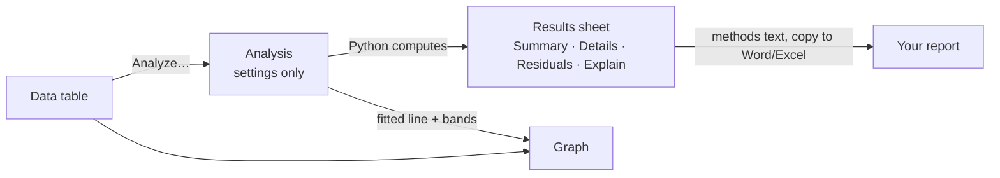

# Datum Plot 0.2: statistics and regression — what we build next

Status: **answered (session 5); 0.2.0 built.** The release order in §9 replaces §5.

The full catalogue is [PLAN-0.2.md](PLAN-0.2.md) §4 (order in §10). This file takes the **0.2 part** and says exactly what you will see, how it works, and how to split it into releases.

---

## 1. Your feedback on 0.1.1 (25 Oct 2026)

1. You updated from inside the app: about 87 MB, quick to install, opened fast. **Good.**
2. **One file only.** Don't publish a separate 2 MB update and a runtime pack; it confuses people. One installer per release: people who have it installed update from the app, new people download that same file.
   **Done** (in the next release): each release now has just `DatumPlot-x.y.z-setup.exe` (and the small `SHA256SUMS.txt` the updater uses to check the download). Python still sits inside it and is only unpacked again when its libraries change, so starts stay fast.
3. Import "kind of works" (not tested much yet). **Copy Picture works now.**
4. The app is still missing a lot. List what comes next, brainstorm, then start.

## 2. What 0.2 adds, in one picture

- **Results become real items** in the navigator (under Results), each linked to its table. Change a value and the result and the fitted line on the graph update, as in Prism.
- Everything is computed in the built-in Python (numpy, SciPy, **statsmodels**, **lmfit**) and checked against R and the NIST reference data sets in tests.

## 3. The list for 0.2 (what you will see)

### 3.1 Results, the foundation (C1–C3, C5–C9)
| What | How it looks |
| --- | --- |
| **Results sheet** (C1, C2) | Analyze… → pick an analysis → a short options dialog (which data sets, options) → a new item under Results. Tabs: **Summary** (the few numbers that matter), **Details** (everything, e.g. the ANOVA table and covariances), **Residuals**, **Data used**. |
| **Explain panel** (C3) | Beside the tables: what was asked, the answer in one sentence ("The slope is 205 GPa (95 % CI 198–212); the line explains 99.6 % of the variation."), and checks with ✓/⚠ (normal residuals, no runs, enough points). |
| **Methods text** (C5) | Ready to paste: "Data were fitted by least-squares linear regression in Datum Plot 0.2.0 (Python 3.13, SciPy 1.18)…" plus a figure-legend sentence. |
| **P values** (C6) | Exact P values with APA stars by default; other styles in Options. |
| **Copy** (C7) | Copy any results table as a table for Excel or Word. (Excel files in 0.2.2.) |
| **Show as Python code** (C8) | The exact numpy/SciPy code that reproduces the result, to check it outside the app. |
| **Checklist** (C9) | Warnings such as "only 4 points", "curvature in the residuals", "the fit did not converge". |

### 3.2 Statistics (B1–B3, A16, D4)
| What | Details |
| --- | --- |
| **Descriptive statistics** (B1) | Per data set or per row: n, mean, SD, SEM, 95 % CI, median, quartiles, min, max, range, CV %, geometric mean and SD, skewness, kurtosis. |
| **Normality** (B2) | Shapiro-Wilk, D'Agostino-Pearson, Anderson-Darling, Kolmogorov-Smirnov, with a **QQ plot** as a graph. |
| **Outliers** (B3, A16) | Grubbs' test and ROUT (Q = 1 %); outliers listed and **excluded in one click** (blue, as today). |
| **Histogram** (D4) | Frequency distribution with bin width, relative or cumulative, with a fitted normal curve. |

### 3.3 Linear regression (B9, D5) — the centre of 0.2.0
| What | Details |
| --- | --- |
| **Straight line** | Slope, intercept with standard errors and 95 % CI, R², adjusted R², Sy.x, F and P (is the slope different from zero?), X-intercept, runs test, residuals. |
| **Fit range** | Fit only X from … to … (e.g. the elastic region of a stress–strain curve). Typed in 0.2.0; dragged on the graph later (E5). |
| **Options** | Force through the origin (or a given point), weighting (1/Y², 1/SD²), all replicates or only the means, polynomial of order 2–6, **Deming regression** (errors in X and Y). |
| **Compare lines** | Are the slopes (then intercepts) of the data sets different? (F test, as Prism.) |
| **On the graph** (D5) | The fitted line, 95 % confidence band and prediction band, and optionally the **equation and R² on the graph**. A **residual plot** as its own graph. |
| **Interpolate** | Read X from Y (or Y from X) off the line for unknowns. |

### 3.4 Curve fitting (B10–B14)
| What | Details |
| --- | --- |
| **Nonlinear fit** (B10) | Any equation, with initial values found automatically, bounds, fixed parameters, weighting, robust fitting, 95 % CIs (asymptotic and profile), R², AICc. Uses **lmfit** (built on SciPy). |
| **Model library** (B11) | Exponential growth and decay (1 and 2 phases, with plateau), power law, logarithmic, logistic and Gompertz, Gaussian, Lorentzian, Voigt, dose-response (3/4/5 parameters), Michaelis-Menten, Hill, Arrhenius, Avrami (JMAK), Langmuir and Freundlich isotherms, polynomials, and **your own equation** typed as `Y = A*exp(-k*X) + C`. |
| **Global fits and comparing models** (B12) | Share a parameter between data sets; is model 2 better than model 1 (F test, AICc)? Is k different between two data sets? |
| **Standard curves** (B13) | Fit standards, read unknowns with confidence intervals. |
| **Area and smoothing** (B14) | Area under the curve (with baseline), derivative, integral, Savitzky-Golay and LOWESS smoothing. |

### 3.5 Data tools and graph style (A15, A17, A18, D13, D14, D16, G4, G6, C4, J3)
| What | Details |
| --- | --- |
| **Transforms** (A15) | New linked table: log, ln, 1/X (Arrhenius), X², normalise, subtract baseline, unit conversions (MPa ↔ GPa, °C ↔ K), row means. |
| **Sort, find, filter, data checks** (A17, A18) | Sort by X, find values, warnings for text in number cells or repeated X. |
| **Styles, copy look, colour schemes** (D13, D14, D16) | Prism, Origin, Nature, ACS, IEEE, greyscale, presentation; apply one graph's look to others; palettes. |
| **Batch export, Excel** (G4, G6) | Every graph at once; tables and results as an .xlsx workbook. |
| **Test chooser, statistics guide** (C4, J3) | A few questions open the right analysis; a short guide on which test when. |

### 3.6 New ideas for materials science (new IDs, for your opinion)
| ID | What | Python |
| --- | --- | --- |
| **B27** | **Tensile test analysis**: from stress–strain data, Young's modulus (linear fit of the elastic region), 0.2 % offset yield strength, ultimate tensile strength, elongation at break, toughness (area); per specimen and as mean ± SD. | numpy, SciPy |
| **B28** | **Arrhenius / activation energy**: ln(k) vs 1/T with Ea and the pre-factor and their CIs, in kJ/mol or eV. | SciPy |
| **B29** | **Weibull analysis**: Weibull modulus and characteristic strength from fracture data, with the Weibull plot and confidence bounds. | SciPy |
| B30 | Fatigue S–N curves (Basquin fit, log–log). | SciPy |
| B31 | DSC/TGA peak areas and onset temperatures (part of peak analysis). | SciPy |

## 4. How it is built (short)

- **Rust core:** a new item `Analysis { id, kind, table, data sets, options }` with ops to add, change and delete it (settings only, with undo); graphs get "overlays" (a fitted line from an analysis).
- **Python:** `py/datum/analyses/` with one module per family (`describe.py`, `normality.py`, `outliers.py`, `linear.py`, `fit.py` + `models.py`), each returning the same result shape: tables, a one-sentence answer, checks, methods text, Python code, and curves for the graph. A results cache by revision, and a **second Python worker** for long fits so graphs never wait (I3).
- **Window:** a Results view (tabs + Explain panel), an options dialog per analysis, the Analyze gallery's buttons become real.
- **Tests:** every statistic against R; regression against the NIST StRD sets (Norris, Pontius, Longley; Misra1a, Thurber, MGH09 for nonlinear).
- **Libraries:** statsmodels and lmfit are added to the Python pack (about +45 MB unpacked); `py/runtime.txt` goes to 2 so it is unpacked once more.

## 5. Release split (proposal)

0.2 is too big for one step. Three releases, each one you can try:

| Version | Contents | Size |
| --- | --- | --- |
| **0.2.0** | Results foundation (C1–C3, C5–C9), descriptive statistics (B1), normality + QQ (B2), outliers + exclude (B3, A16), **linear regression** with fit range, polynomial, Deming, compare lines, line + bands + equation on the graph, residual plot, interpolation (B9, D5); samples: tensile modulus, Arrhenius, calibration line | big |
| **0.2.1** | **Curve fitting** with the model library and your own equations, global fits, model comparison, standard curves, area/smoothing (B10–B14), second worker (I3); **tensile test analysis (B27) and Weibull (B29)** if you want them | big |
| **0.2.2** | Transforms incl. unit conversion and 1/T (A15), sort/find/checks (A17, A18), histogram (D4), graph styles, copy look, colour schemes (D13, D14, D16), batch export and Excel (G4, G6), test chooser and guide (C4, J3) | medium |

Then 0.3 compare groups (t-tests, ANOVA, column graphs, significance brackets), as agreed.

## 6. What stays as it is
Every planned command in the ribbon keeps its place; as each feature ships, its button becomes real and the Roadmap ticks it.

## 7. Releases
One installer per release (`DatumPlot-x.y.z-setup.exe`), used for new installs and by Update now.

## 8. Questions

1. **Split:** OK to ship 0.2 as 0.2.0 (linear regression + results), 0.2.1 (curve fitting), 0.2.2 (data tools and styles)?
2. **Materials analyses:** which of B27 tensile, B28 Arrhenius, B29 Weibull, B30 S–N, B31 DSC do you want, and how soon? (Proposal: B28 in 0.2.0, B27 and B29 in 0.2.1, B30–B31 later.)
3. **Results style:** a short Summary tab (Prism) plus a full Details tab (Origin's report) — OK?
4. **On the graph:** show the equation and R² next to a fitted line by default, or only when asked?
5. **Replicates in regression:** fit every replicate point (Prism's default, better statistics) or only the means? (Proposal: every point, with a switch.)
6. Anything from your materials work you used often that is not in this list (hardness, creep, XRD peak fitting, particle size distributions…)?

---

## 9. Answers (session 5) and the release order

- **Combine** the first two parts into one **0.2.0**. Then go on in **small consecutive releases, 0.2.1, 0.2.2, 0.2.3 …** up to 0.3, without jumping numbers. Small updates are quicker to build, to check and to fix (and cheaper).
- **Materials:** Arrhenius yes (in 0.2.0); tensile and Weibull as suggested (0.2.3).
- **Questions 3–6:** as proposed — short Summary tab + full Details; equation and R² shown on the graph by default (can be switched off); regression uses every replicate point by default (switch to means); further materials ideas stay in the catalogue (B30, B31) for later.

| Version | Contents | IDs |
| --- | --- | --- |
| **0.2.0** ✅ | Results sheets with Explain, methods text, P values, copy, Python code, checklist; descriptive statistics; normality; outliers with one-click exclude; linear regression (fit range, through origin, polynomial, Deming, compare lines, interpolation); nonlinear curve fitting with the model library and your own equation; Arrhenius / activation energy; fitted curves with bands and equation on the graph; residual plots | C1–C3, C5–C9, B1–B3, A16, B9–B11, B13, B28, D5 |
| 0.2.1 | Data tools: transforms (log, 1/T, normalise, baseline, unit conversions), sort/find/filter, data checks, histograms and QQ graphs | A15, A17, A18, D4 |
| 0.2.2 | Global fits and model comparison, area under curve and smoothing, a second Python worker | B12, B14, I3 |
| 0.2.3 | Tensile test analysis, Weibull analysis | B27, B29 |
| 0.2.4 | Graph styles, copy look, colour schemes | D13, D14, D16 |
| 0.2.5 | Batch export, Excel export, test chooser, statistics guide, samples | G4, G6, C4, J3, J2 |
| 0.3.x | Compare groups (split into small steps when planned) | A2, B4–B8, D2, D3, E7 |
