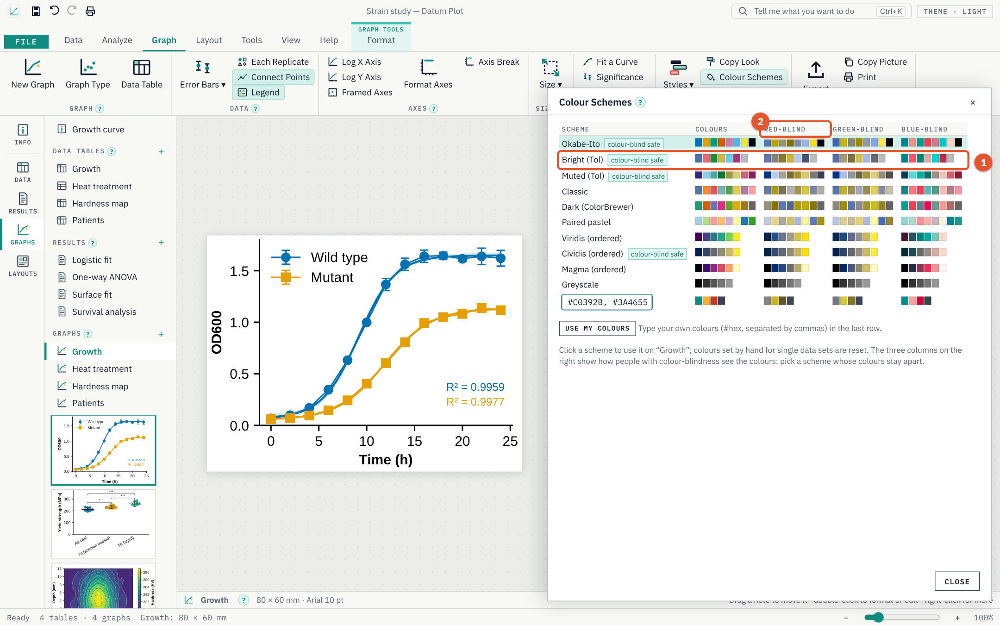

# Guide Datum Plot

## Bienvenue

Datum Plot est un logiciel pour Windows qui analyse des données scientifiques et produit des graphiques prêts à publier. Vous saisissez, collez ou importez vos données dans un tableau, vous choisissez une analyse, et Datum Plot affiche les résultats accompagnés d’une conclusion en langage simple, trace le graphique et met en page la figure pour une revue, un poster ou une diapositive. Tout reste lié : modifiez une valeur du tableau, et chaque résultat et chaque graphique qui l’utilisent se mettent à jour.

Les calculs et les tracés sont réalisés par Python (numpy, SciPy et matplotlib), intégré à l’application. Rien d’autre n’est à installer, et vos données ne quittent jamais votre ordinateur.

Ce guide vous accompagne pas à pas dans Datum Plot, de l’installation jusqu’à la figure exportée. Inutile de le lire d’une traite : chaque chapitre se suffit à lui-même.

Comment lire ce guide :

- L’interface de Datum Plot est en anglais. Les noms en **gras** sont les onglets, boutons et champs tels qu’ils apparaissent dans Datum Plot, suivis de leur sens en français entre parenthèses, par exemple **Test Chooser** (Choix du test). Il suffit de chercher le nom anglais dans le logiciel.
- Une flèche › indique un chemin : **Analyze › Test Chooser** (Analyser › Choix du test) signifie l’onglet **Analyze**, puis le bouton **Test Chooser**.
- Les touches sont notées ainsi : [[Ctrl+S]].
- Les numéros orange sur les images correspondent aux listes numérotées placées en dessous.

> **Astuce.** Presque chaque outil de Datum Plot a un petit **?** à côté de son nom. Cliquez dessus pour ouvrir une courte fiche qui explique à quoi sert l’outil et comment l’utiliser.

## Installer, mettre à jour et démarrer

### Installation

1. Téléchargez `DatumPlot-x.y.z-setup.exe` depuis la page des versions (Releases) : github.com/Edgar-Mendonca/Datum-Plot/releases.
2. Lancez-le. Il s’installe pour votre propre compte Windows : les droits d’administrateur ne sont pas nécessaires.
3. La première fois, Windows peut afficher **Windows protected your PC** (Windows a protégé votre ordinateur), car le programme d’installation n’est pas encore signé. Cliquez sur **More info** (Informations complémentaires), puis sur **Run anyway** (Exécuter quand même).

Le premier démarrage prend un peu plus de temps, le temps que Datum Plot prépare son moteur Python. La barre d’état indique **Ready** (Prêt) une fois le moteur démarré.

### Mises à jour

Datum Plot recherche une nouvelle version à chaque démarrage. Lorsqu’une version est disponible, un bouton **Update x.y.z available** (Mise à jour x.y.z disponible) apparaît dans la barre de titre ; cliquez dessus, ou ouvrez **File › Updates** (Fichier › Mises à jour) et cliquez sur **Update now** (Mettre à jour maintenant). Le téléchargement est vérifié par sa somme de contrôle avant l’installation, puis Datum Plot redémarre tout seul. Vos projets ne sont pas modifiés.

### La page Home

1. **Blank XY table** (Tableau XY vide). Un tableau XY vide avec son graphique, prêt à recevoir vos données.
2. **Samples** (Exemples). Chaque exemple est un petit projet complet, avec des données réalistes, une analyse et un graphique : courbes de croissance et courbes d’étalonnage, dose-réponse, comparaisons de groupes, essais de traction, études de survie, comparaison de méthodes, tests diagnostiques, surfaces de réponse, diagrammes polaires, spectres, courbes DSC et ATG, et bien d’autres. Ouvrez-en un pour voir à quoi ressemble un projet abouti, puis remplacez les données par les vôtres.
3. **La page File** (Fichier). **New** (Nouveau), **Open** (Ouvrir), **Import** (Importer), **Save** (Enregistrer), **Save As** (Enregistrer sous), **Export** (Exporter) et **Print** (Imprimer), et en dessous **Roadmap** (Feuille de route), **Options** (Options) et **Updates** (Mises à jour). La flèche en haut ramène au projet.

Plus bas sur la page **Home** (Accueil) se trouvent la vignette **Guide** (ce guide, en anglais, en chinois ou en français) et vos projets récents.

## La fenêtre en un coup d’œil

1. **Onglets.** **File** (Fichier) ouvre la page Fichier. **Data** (Données), **Analyze** (Analyser), **Graph** (Graphique), **Layout** (Mise en page), **Tools** (Outils), **View** (Affichage) et **Help** (Aide) affichent chacun leur propre ruban.
2. **Ruban.** Les outils de l’onglet actif, rangés en groupes nommés. Quand la fenêtre est étroite, les groupes se replient en boutons plus petits.
3. **Barre latérale.** Permet de passer de la feuille **Info** (Informations) du projet aux **Data** (Données), **Results** (Résultats), **Graphs** (Graphiques) et **Layouts** (Mises en page).
4. **Navigator** (Navigateur). Tous les tableaux de données, résultats, graphiques et mises en page du projet, avec des miniatures des graphiques. Faites un clic droit sur un élément pour le renommer, le dupliquer ou le supprimer.
5. **L’élément ouvert.** Ici un graphique ; ce peut aussi être un tableau de données, une feuille de résultats ou une mise en page.

Le champ **Tell me what you want to do** (Dites-moi ce que vous voulez faire), en haut (ou [[Ctrl+K]]), trouve n’importe quelle commande par son nom : tapez « log axis » (axe logarithmique) ou « t-test » (test t) et appuyez sur [[Enter]].

### Comment un projet est lié

Un projet contient des tableaux de données, des analyses, des graphiques et des mises en page :

- Un **data table** (tableau de données) contient les nombres.
- Une **analysis** (analyse) lit un tableau de données et produit une **results sheet** (feuille de résultats).
- Un **graph** (graphique) trace un tableau de données et peut afficher les courbes et les étoiles de significativité de ses analyses.
- Une **layout** (mise en page) dispose des graphiques et du texte sur une page.

Quand vous modifiez une valeur, chaque résultat et chaque graphique qui en dépendent sont recalculés. Vous n’avez jamais besoin d’« actualiser ».

## Tableaux de données

### Types de tableau

Choisissez le type de tableau qui correspond à votre expérience : **Data › New Table** (Données › Nouveau tableau).

1. **Familles de tableaux.** Data tables (tableaux de données), et Worksheets and 3D (feuilles de calcul et 3D).
2. **Les types.** Cliquez sur un type pour lire à quoi il sert ; double-cliquez pour le créer.

| Type | Ce qu’il contient | Analyses typiques |
|---|---|---|
| **XY** | des valeurs X (temps, dose, déformation…) et des séries Y avec réplicats | régression, ajustement de courbe |
| **Column** (Colonnes) | chaque colonne est un groupe | tests t, ANOVA, Bland-Altman, ROC |
| **Grouped** (Groupé) | deux facteurs : les lignes et les séries de données | ANOVA à deux facteurs |
| **Contingency** (Contingence) | effectifs des issues par groupe | khi-deux, test exact de Fisher |
| **Survival** (Survie) | une ligne par sujet : le temps, et 1 (événement) ou 0 (censuré) | Kaplan-Meier, test du log-rank |
| **Parts of whole** (Parties d’un tout) | les parts d’un total | fractions, secteurs et anneaux |
| **Many variables** (Variables multiples) | une ligne par échantillon, de nombreuses propriétés | régression multiple, ACP, classification |
| **Nested** (Imbriqué) | des groupes avec sous-groupes (lots, animaux) | test t et ANOVA imbriqués |
| **Worksheet** (Feuille de calcul) | des colonnes libres avec rôles, unités et formules | données brutes d’instrument |
| **Matrix** (Matrice) | des valeurs Z sur une grille X–Y | cartes de contours, surfaces 3D, ajustements de surface |

### Saisir les données

1. **Data › Insert** (Données › Insérer). **New Table** (Nouveau tableau), **Import** (Importer), **Several Files** (Plusieurs fichiers), **Add Data Set** (Ajouter une série), **Remove Data Set** (Supprimer une série) et les lignes.
2. **En-têtes.** Le titre et les unités de X, et le titre de chaque série de données. Double-cliquez sur un en-tête pour le modifier, ainsi que les réplicats ou le mode de saisie des valeurs.
3. **Cellules.** Tapez une valeur et appuyez sur [[Enter]]. Le copier-coller fonctionne avec les tableurs ([[Ctrl+C]], [[Ctrl+V]]) ; [[Ctrl+D]] recopie vers le bas.

Une série de données peut être saisie sous forme de réplicats (chaque valeur dans sa propre colonne) ou sous forme de **mean, SD and N** (moyenne, écart-type et N) ou de **mean, SEM and N** (moyenne, erreur-type de la moyenne et N) tirés d’un article ou d’un autre logiciel : choisissez-le dans l’en-tête de la série.

Pour exclure une valeur des graphiques et des analyses sans la supprimer, sélectionnez-la et appuyez sur [[Ctrl+E]] (**Exclude / Include**, Exclure / Inclure). Les valeurs exclues apparaissent en italique bleu, barrées.

### Formules et transformations

- **Data › Column Formula** (Données › Formule de colonne) remplit une colonne à partir des autres, par exemple `(B - A) / A * 100`. La colonne se met à jour quand les données changent.
- **Data › Transform** (Données › Transformer) crée un nouveau tableau de valeurs transformées : logarithmes, 1/X, °C en K, soustraction d’une ligne de base, normalisation.
- **Data › Check Data** (Données › Vérifier les données) recherche les fautes de frappe, les valeurs manquantes et les valeurs qu’un axe logarithmique ne peut pas afficher.

### Importer

**Data › Import** (Données › Importer), ou **File › Import** (Fichier › Importer), lit les fichiers CSV, TXT et TSV, les classeurs .xlsx et les projets .pzfx. Un aperçu montre comment les colonnes seront lues ; choisissez la ligne d’en-tête et les réplicats, puis cliquez sur **Import**. **Data › Several Files** (Données › Plusieurs fichiers) importe de nombreuses séries de mesures d’un coup : une série de données par fichier dans un seul tableau lorsqu’ils partagent les mêmes valeurs X, sinon un tableau par fichier. Les plans de microplaques (96 et 384 puits) sont reconnus.

## Analyses et résultats

### Choisir une analyse

1. **Analyze… et Test Chooser.** **Analyze…** (Analyser…) liste toutes les analyses ; **Test Chooser** (Choix du test) vous pose trois questions sur vos données et propose le test adapté.

Les autres groupes de l’onglet **Analyze** (Analyser) lancent directement une analyse : **Statistics** (Statistiques), **Compare Groups** (Comparer des groupes), **Regression** (Régression), **Materials** (Matériaux) et d’autres.

1. **Groupes.** Statistiques, régression et ajustement, matériaux, comparaison de groupes, relations, survie, signaux et spectres.
2. **Analyses.** Cliquez sur une analyse pour lire ce qu’elle fait et quelles bibliothèques Python elle utilise ; **Next…** (Suivant…) demande quelles séries de données inclure et quelles options appliquer.

### La feuille de résultats

1. **Tableaux de résultats.** Les valeurs, avec leurs erreurs-types et leurs intervalles de confiance à 95 %. **Copy** (Copier) copie un tableau pour un tableur ou un document.
2. **La réponse.** Ce que l’analyse a trouvé, en termes simples.
3. **Vérifications.** Si les hypothèses sont respectées (par exemple, si les résidus se dispersent au hasard), avec une coche ou un avertissement.

En dessous se trouvent le texte **Methods** (Méthodes), prêt à coller dans un article (**Copy methods text**, Copier le texte des méthodes), et la légende de la figure. **Change…** (Modifier…) rouvre les options ; **Python code** (Code Python) montre le code Python à l’origine du résultat, pour le reproduire ailleurs. Cochez **Show on graph** (Afficher sur le graphique) pour tracer un ajustement ou les étoiles de significativité sur le graphique.

> **Astuce.** Vous ne savez pas ce que signifie une valeur ? Cliquez sur le **?** à côté, ou ouvrez **Help › Glossary** (Aide › Glossaire).

### Ce que Datum Plot sait analyser

- **Statistiques :** statistiques descriptives, tests de normalité, valeurs aberrantes, distributions de fréquences, fractions d’un total.
- **Comparaison de groupes :** tests t (non apparié, de Welch, apparié), tests non paramétriques, ANOVA à un et à deux facteurs avec comparaisons multiples, mesures répétées et modèles à effets mixtes, tests t et ANOVA imbriqués, tailles d’effet, puissance.
- **Relations :** corrélation, comparaison de méthodes de Bland-Altman, courbes ROC, tableaux de contingence (khi-deux, Fisher, risque relatif, rapport des cotes).
- **Régression et ajustement :** régression linéaire, ajustement de courbe à partir d’une bibliothèque de modèles ou de votre propre équation, ajustements globaux et comparaison de modèles, interpolation, aire sous la courbe, lissage, régression multiple, logistique et de Poisson, analyse en composantes principales et classification, ajustements de surface.
- **Survie :** courbes de Kaplan-Meier, test du log-rank et rapports de risques instantanés (hazard ratios).
- **Signaux et spectres :** détection de pics, ajustement de pics gaussiens, lorentziens et de Voigt, spectres de Fourier et filtres.
- **Matériaux :** essais de traction, résistance de Weibull, énergies d’activation d’Arrhenius, courbes de fatigue S–N, analyse thermique DSC et ATG.

## Graphiques

### L’onglet Graph

1. **Graph** (Graphique). **New Graph** (Nouveau graphique), **Graph Type** (Type de graphique : nuage de points, barres, boîte à moustaches, violon, avant–après, courbes et d’autres) et **Data Table** (Tableau de données, pour revenir aux données).
2. **Axes** (Axes). Axes logarithmiques, axes encadrés, **Format Axes** (Mettre en forme les axes) et **Axis Break** (Coupure d’axe).
3. **Style** (Style). Des **Styles** (Styles) prêts à l’emploi pour les revues et les présentations, **Copy Look** (Copier l’apparence) vers d’autres graphiques, et **Colour Schemes** (Jeux de couleurs, dont certains adaptés aux daltoniens).
4. **Share** (Partager). **Export** (Exporter), **Copy Picture** (Copier l’image, à coller directement dans un document ou des diapositives) et **Print** (Imprimer).

Les autres groupes règlent les **Error Bars** (Barres d’erreur), affichent **Each Replicate** (Chaque réplicat), relient les points, affichent la légende, fixent la **Size** (Taille) et ajoutent un ajustement de courbe, des étoiles de significativité ou des annotations.

### Mettre en forme un graphique

Double-cliquez sur n’importe quelle partie d’un graphique (un axe, une série de données, le titre) pour la mettre en forme, ou utilisez **Graph › Format Axes** (Graphique › Mettre en forme les axes).

1. **Pages.** **Data Sets** (Séries de données : symboles, couleurs, lignes, barres d’erreur, axe Y de droite), **X Axis** (Axe X), **Y Axis** (Axe Y), **Graph** (Graphique : taille et polices) et les notes.
2. **Réglages.** Les modifications s’appliquent immédiatement.
3. **Le graphique** reste visible pendant que vous travaillez.

### Couleurs

1. **Jeux de couleurs.** Cliquez sur l’un d’eux : le graphique change aussitôt, car la fenêtre se place à côté du graphique. Les jeux marqués **colour-blind safe** (adapté aux daltoniens) restent faciles à distinguer pour les personnes atteintes de l’un des trois types courants de daltonisme ; le jeu par défaut, Okabe-Ito, en fait partie.
2. **Ce que voient les lecteurs daltoniens.** Les trois colonnes montrent chaque jeu tel que le voient les personnes atteintes de protanopie, de deutéranopie et de tritanopie.

Vos propres couleurs se saisissent dans la dernière ligne (#hex, séparées par des virgules). Dans **Format Graph › Data Sets** (Mettre en forme le graphique › Séries de données), la case de couleur de chaque série montre la couleur avec laquelle elle est tracée, et les couleurs rapides à côté sont celles du jeu choisi. Toute fenêtre se déplace en faisant glisser sa barre de titre.

### Travailler sur le graphique

- Survolez un point pour voir ses valeurs.
- Faites glisser une note pour la déplacer ; double-cliquez dessus pour la modifier.
- Faites un clic droit sur un point pour l’exclure.
- **Zoom to a Box** (Zoomer sur un cadre), **Pan** (Déplacer la vue) et **Statistics of a Region** (Statistiques d’une zone) se trouvent dans le menu contextuel du graphique ; [[Ctrl]] et la molette de la souris zooment la vue.

### Des graphiques pour chaque type de données

Les graphiques XY peuvent aussi être des graphiques polaires (**Format Graph › Graph › Polar**, Mettre en forme le graphique › Graphique › Polaire) ; les tableaux matrices peuvent être tracés en cartes de contours, cartes de chaleur, surfaces 3D ou maillages filaires.

## Mises en page et export

### Mises en page

Une mise en page dispose plusieurs graphiques et du texte sur une même page : une figure à plusieurs panneaux pour une revue, un poster ou une diapositive.

1. **Layout** (Mise en page). **New Layout** (Nouvelle mise en page), **Panel Letters** (Lettres des panneaux : A, a, (a)), **Arrange** (Disposer : aligner et dimensionner les panneaux), **Journal Figure** (Figure de revue : sur une ou deux colonnes d’une revue) et **Add Graph** (Ajouter un graphique).
2. **La page.** Faites glisser un panneau pour le déplacer ; faites glisser un coin pour le redimensionner. Faites un clic droit sur un panneau pour d’autres choix.

Le groupe **Templates** (Modèles) crée un **Poster** (Poster) ou une **Slide** (Diapositive). Le groupe **Export** (Exporter) enregistre la page.

### Export

1. **File › Export** (Fichier › Exporter) exporte le graphique ouvert.
2. **Formats.** **PNG** pour les diapositives et le web ; **TIFF** (300–1200 dpi, en CMJN si demandé) pour les revues ; les formats vectoriels **SVG**, **PDF** et **EPS**, qui restent nets à toutes les tailles. **Copy picture** (Copier l’image) place le graphique dans le presse-papiers.

Autres façons de partager, dans **Tools** (Outils) :

- **Export All Graphs** (Exporter tous les graphiques) en une fois.
- **Workbook** (Classeur) : tous les tableaux et résultats, en feuilles d’un fichier .xlsx ou .ods.
- **Slides** (Diapositives) : chaque graphique sur sa propre diapositive, et une diapositive par résultat (.pptx ou .odp).
- **Document** : les informations du projet, chaque graphique avec sa légende, chaque résultat et le texte des méthodes (.docx ou .odt).

Choisissez le type de fichier dans la boîte d’enregistrement. Les fichiers .ods, .odt et .odp sont au format OpenDocument, la norme ouverte.

### Impression

**File › Print** (Fichier › Imprimer) imprime un graphique avec un en-tête et un pied de page, ou l’enregistre en PDF.

## La console Python et l’automatisation

### Console Python

La console Python exécute votre propre code Python sur les données du projet.

1. **Code.** Écrivez le code Python ici. Vos tableaux sont disponibles sous forme de DataFrames pandas : `tables` les liste, `table(0)` est le premier, `tables['Name']` en désigne un par son nom.
2. **Run** (Exécuter), ou [[Ctrl+Enter]].
3. **Sortie.** Ce que vous affichez avec print, la valeur de la dernière ligne et toute figure que vous tracez avec `plt`.
4. **How to use** (Mode d’emploi). Un court guide intégré à la console ; **Examples** (Exemples) insère du code fonctionnel comme point de départ.

Prêts à l’emploi : `np` (numpy), `pd` (pandas), `stats` (scipy.stats), `scipy` et `plt` (matplotlib). `new_table('Name', data)` ajoute un tableau au projet ; `result('Analysis name')` renvoie les valeurs d’une analyse. Les variables sont conservées d’une exécution à l’autre jusqu’à ce que vous cliquiez sur **Reset** (Réinitialiser).

> **Remarque.** La console exécute le code que vous écrivez, avec vos droits, comme n’importe quel script Python. Les projets ne contiennent jamais de code : ouvrir un projet reçu de quelqu’un d’autre n’exécute jamais rien.

### Automatisation

1. **Python.** **Python Console** (Console Python), **My Analyses** (Mes analyses : le code enregistré avec **Save As My Analysis**, Enregistrer comme mon analyse) et **Notebook** (Notebook : le projet sous forme de notebook Jupyter).

- **Analysis Template** (Modèle d’analyse) reproduit sur d’autres tableaux les analyses d’un tableau (avec leurs options) et l’apparence de son graphique.
- **Batch Process** (Traitement par lots) prend un tableau modèle et de nombreux fichiers : chaque fichier devient un tableau avec ces analyses et un graphique, et les réponses sont regroupées dans une même liste.

## Fichiers

- **Save** (Enregistrer, [[Ctrl+S]]) conserve tout le projet dans un seul fichier `.dplot` : tableaux, analyses, graphiques et mises en page. L’enregistrement est atomique : un plantage ou un disque plein ne laisse jamais un fichier à moitié écrit.
- **Open** (Ouvrir, [[Ctrl+O]]) ouvre un fichier `.dplot` ; vous pouvez aussi double-cliquer dessus dans Windows.
- Datum Plot enregistre une copie de récupération toutes les quelques minutes (**File › Options**, Fichier › Options). S’il se ferme de façon inattendue, il propose de récupérer votre travail au démarrage suivant.
- **Undo** (Annuler) et **Redo** (Rétablir), [[Ctrl+Z]] et [[Ctrl+Y]], permettent de revenir sur chaque modification.

## L’aide dans l’application

1. **Learn** (Apprendre). **Guide** (ce guide), **Getting Started** (Premiers pas), **Roadmap** (Feuille de route : ce que Datum Plot fera, et quand), **Glossary** (Glossaire), **What Is This Tool?** (Qu’est-ce que cet outil ?), **Statistics Guide** (Guide des statistiques), **Test Chooser** (Choix du test), **Shortcuts** (Raccourcis) et **Tell Me** (Dites-moi).
2. **Updates** (Mises à jour). **Check for Updates** (Rechercher des mises à jour).

1. **Langues.** English, 中文 or Français. Le guide est téléchargé depuis GitHub, vérifié par sa somme de contrôle, enregistré dans votre dossier Téléchargements, puis ouvert.

## Quel test choisir

| Votre question | Vos données | Analyse |
|---|---|---|
| Deux groupes diffèrent-ils ? | deux colonnes de valeurs | test t (Mann-Whitney si la distribution n’est pas normale) |
| Les mêmes éléments ont-ils changé ? | avant et après, appariés par ligne | test t apparié (Wilcoxon si la distribution n’est pas normale) |
| Trois groupes ou plus diffèrent-ils ? | des colonnes de valeurs | ANOVA à un facteur avec comparaisons multiples (Kruskal-Wallis si la distribution n’est pas normale) |
| Deux facteurs ont-ils un effet ? | tableau groupé | ANOVA à deux facteurs (à mesures répétées si les mêmes sujets sont mesurés plusieurs fois) |
| Les proportions sont-elles différentes ? | des effectifs | khi-deux ou test exact de Fisher |
| Quelle relation entre X et Y ? | XY | régression linéaire ou ajustement de courbe |
| Deux variables varient-elles ensemble ? | deux colonnes | corrélation |
| Deux méthodes concordent-elles ? | valeurs appariées | Bland-Altman |
| Un test détecte-t-il bien une affection ? | valeurs des témoins et des cas | courbe ROC |
| Combien de temps avant un événement ? | temps avec événements et sujets censurés | Kaplan-Meier et test du log-rank |

> **Astuce.** **Analyze › Test Chooser** (Analyser › Choix du test) vous pose ces questions.

## Glossaire

| Terme | Signification |
|---|---|
| **Data set** (Série de données) | Une série de valeurs dans un tableau (une colonne, ou un groupe de colonnes de réplicats). |
| **Replicate** (Réplicat) | Une mesure répétée de la même chose. |
| **SD** (Écart-type) | Mesure de la dispersion des valeurs. |
| **SEM** (Erreur-type de la moyenne) | Précision avec laquelle la moyenne est connue (SD/√n). |
| **95% CI** (Intervalle de confiance à 95 %) | L’intervalle qui contient la vraie valeur avec une confiance de 95 %. |
| **P value** (Valeur P) | La probabilité d’observer une différence aussi grande s’il n’existait aucune différence réelle. |
| **R²** | La part de la variation expliquée par la droite ou la courbe ajustée. |
| **Censored** (Censuré) | Un sujet chez qui l’événement ne s’était pas encore produit lors du dernier suivi. |
| **Residual** (Résidu) | L’écart entre un point et la courbe ajustée. |

## Raccourcis et dépannage

### Raccourcis

| Touches | Action |
|---|---|
| [[Ctrl+S]] / [[Ctrl+Shift+S]] | Enregistrer / Enregistrer sous |
| [[Ctrl+O]] / [[Ctrl+N]] | Ouvrir / Nouveau |
| [[Ctrl+Z]] / [[Ctrl+Y]] | Annuler / Rétablir |
| [[Ctrl+C]] / [[Ctrl+V]] | Copier / coller (fonctionne avec les tableurs) |
| [[Ctrl+E]] | Exclure ou inclure des valeurs |
| [[Ctrl+D]] | Recopier vers le bas |
| [[Ctrl+C]] sur un graphique | Copier le graphique comme image |
| [[Ctrl+P]] | Imprimer |
| [[Ctrl+K]] | Dites-moi ce que vous voulez faire |
| [[F1]] | Tous les raccourcis |

### Dépannage

- **La barre d’état indique que le moteur graphique n’est pas disponible.** Cliquez sur **Tools › Restart Engine** (Outils › Redémarrer le moteur). Si le problème persiste, réinstallez Datum Plot depuis la page des versions (Releases) ; vos projets ne sont pas concernés.
- **Une analyse indique qu’elle ne peut pas être calculée.** Le message en donne la raison (trop peu de valeurs, valeurs identiques, X manquant). Corrigez les données ou choisissez d’autres séries de données avec **Change…** (Modifier…).
- **Un graphique n’affiche aucun point sur un axe logarithmique.** Les valeurs nulles ou négatives ne peuvent pas être tracées sur un axe logarithmique ; **Data › Check Data** (Données › Vérifier les données) les repère.
- **Autre problème.** L’étape concernée est refusée et votre projet reste tel quel ; les détails se trouvent dans `crash.log`, dans le dossier de données de l’application. Merci de le signaler via **Help › Report an Issue** (Aide › Signaler un problème).
