# Datum Plot 使用指南

## 欢迎使用

Datum Plot 是一款 Windows 上的科学数据分析与绘图软件，可以制作达到发表要求的图表。您把数据输入、粘贴或导入到数据表中，选择一种分析，Datum Plot 就会给出结果和通俗易懂的结论，绘制图表，并把图排版成适合期刊、海报或幻灯片的插图。所有内容都是相互关联的：修改表中的一个数值，所有用到它的结果和图表都会随之更新。

计算和绘图由软件内置的 Python（numpy、SciPy 和 matplotlib）完成。不需要另外安装任何东西，您的数据也不会离开您的电脑。

本指南一步一步介绍 Datum Plot 的用法，从安装到导出插图。不必一次读完，每一章都可以单独阅读。

阅读说明：

- 软件界面是英文的。本指南中**粗体**的英文是软件中选项卡、按钮和输入框的原名，与软件中显示的完全一致，后面括号里是中文意思，例如 **Test Chooser**（检验选择器）。照着英文名称就能在软件里找到对应的按钮。
- 箭头 › 表示操作路径：**Analyze › Test Chooser** 表示先点 **Analyze**（分析）选项卡，再点 **Test Chooser** 按钮。
- 键盘按键这样表示：[[Ctrl+S]]。
- 截图上的橙色数字与图下方的编号说明一一对应。

> **提示：** Datum Plot 中几乎每个工具名称旁边都有一个小小的 **?**。点击它会弹出一张简短的说明卡片，告诉您这个工具是做什么的、怎么用。

## 安装、更新与启动

### 安装

1. 从发布页面下载 `DatumPlot-x.y.z-setup.exe`：github.com/Edgar-Mendonca/Datum-Plot/releases。
2. 运行安装程序。它只为当前 Windows 用户安装，不需要管理员权限。
3. 第一次安装时，Windows 可能会弹出 **Windows protected your PC**（Windows 已保护你的电脑），因为安装程序目前还没有代码签名。点击 **More info**（更多信息），再点 **Run anyway**（仍要运行）即可。

第一次启动时 Datum Plot 需要准备 Python 计算引擎，所以会稍慢一些。引擎启动后，状态栏会显示 **Ready**（就绪）。

### 更新

Datum Plot 每次启动时都会检查是否有新版本。有新版本时，标题栏会出现 **Update x.y.z available**（有可用更新 x.y.z）按钮；点击它，或者打开 **File › Updates**（文件 › 更新）并点击 **Update now**（立即更新）。下载的安装包会先经过校验和核对再安装，安装完成后 Datum Plot 会自动重新启动。您的项目文件不受影响。

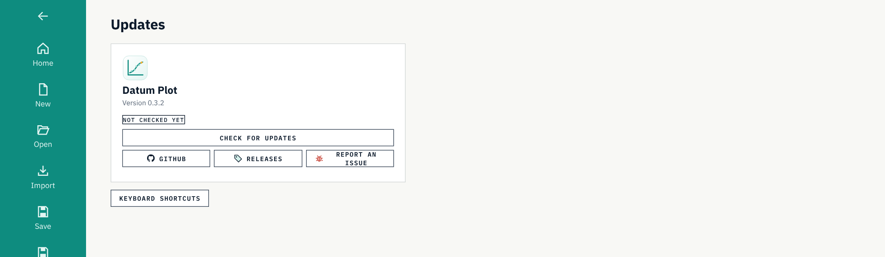

### 主页

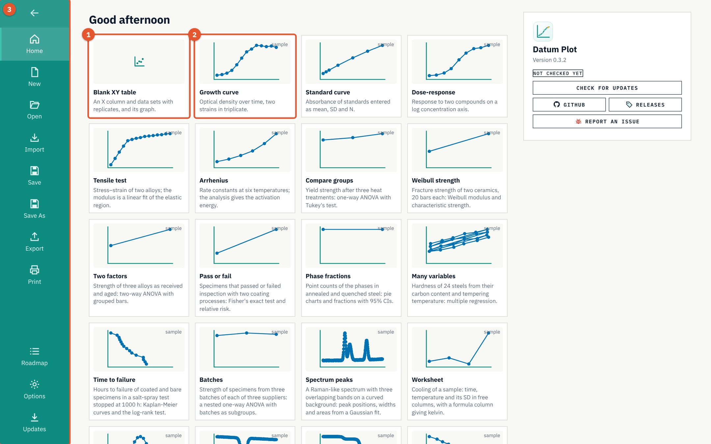

1. **Blank XY table**（空白 XY 表）。一张空的 XY 表及其图表，可以直接输入数据。
2. **Samples**（示例）。每个示例都是一个小而完整的项目，带有逼真的数据、一项分析和一张图表：生长曲线和标准曲线、剂量-反应、组间比较、拉伸试验、生存研究、方法比较、诊断试验、响应面、极坐标图、光谱、DSC 和 TGA 曲线等。打开一个示例看看完成的项目是什么样子，再把数据换成您自己的。
3. **文件页面。** **New**（新建）、**Open**（打开）、**Import**（导入）、**Save**（保存）、**Save As**（另存为）、**Export**（导出）和 **Print**（打印），下面是 **Roadmap**（路线图）、**Options**（选项）和 **Updates**（更新）。顶部的箭头返回到项目。

主页再往下是 **Guide**（指南）磁贴（即本指南，有英文、中文和法文版）以及最近使用的项目。

## 软件界面一览

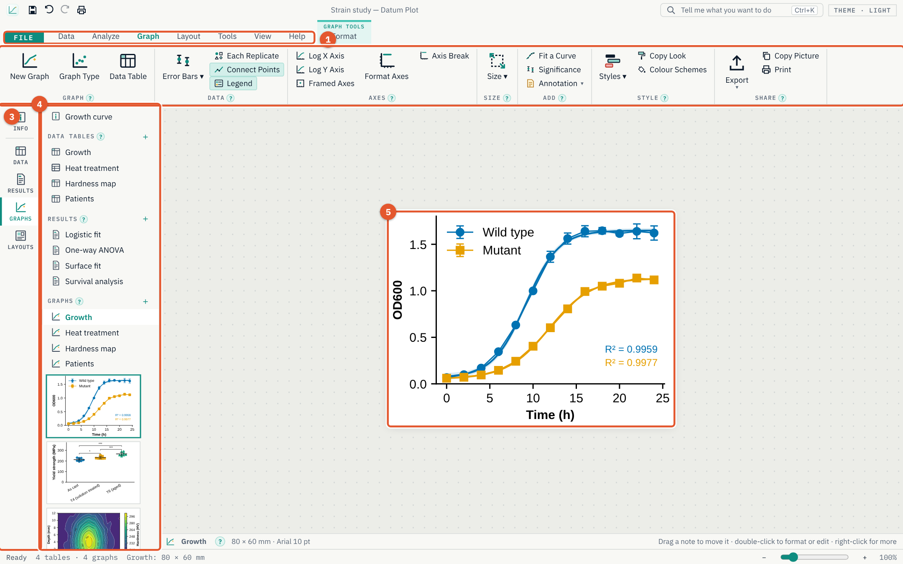

1. **选项卡。** **File**（文件）打开文件页面。**Data**（数据）、**Analyze**（分析）、**Graph**（图表）、**Layout**（版面）、**Tools**（工具）、**View**（视图）和 **Help**（帮助）各自显示自己的功能区。
2. **功能区。** 当前选项卡的工具，按有名称的组排列。窗口较窄时，各组会折叠成较小的按钮。
3. **侧边栏。** 在项目的 **Info**（信息）页、**Data**（数据）、**Results**（结果）、**Graphs**（图表）和 **Layouts**（版面）之间跳转。
4. **Navigator**（导航器）。项目中的每张数据表、每个结果、每张图表和每个版面，图表还带有缩略图。在某一项上点右键可以重命名、复制或删除它。
5. **当前打开的项目内容。** 这里是一张图表；也可以是数据表、结果表或页面版面。

顶部的 **Tell me what you want to do**（告诉我您想要做什么）输入框（或 [[Ctrl+K]]）可以按名称找到任何命令：输入 “log axis” 或 “t-test”，然后按 [[Enter]]。

### 项目内容如何关联

一个项目包含数据表、分析、图表和版面：

- **data table**（数据表）存放数值。
- **analysis**（分析）读取一张数据表，生成一张 **results sheet**（结果表）。
- **graph**（图表）绘制一张数据表，并可以显示其分析得到的曲线和显著性星号。
- **layout**（版面）把图表和文字排在一页上。

修改一个数值后，所有依赖它的结果和图表都会重新计算。您永远不需要手动“刷新”。

## 数据表

### 数据表的类型

选择与您的实验相符的数据表类型：**Data › New Table**（数据 › 新建表）。

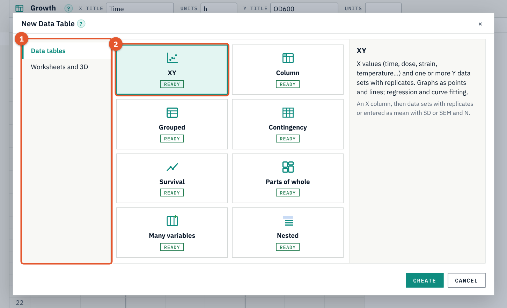

1. **表类型的分组。** Data tables（数据表），以及 Worksheets and 3D（工作表与三维）。
2. **具体类型。** 单击某一类型可阅读它的用途；双击即可创建。

| 类型 | 存放内容 | 常用分析 |
|---|---|---|
| **XY** | X 值（时间、剂量、应变……）和带重复值的 Y 数据集 | 回归、曲线拟合 |
| **Column**（列表） | 每一列是一个组 | t 检验、方差分析、Bland-Altman、ROC |
| **Grouped**（分组表） | 两个因素：行和数据集 | 双因素方差分析 |
| **Contingency**（列联表） | 每组各结局的计数 | 卡方检验、Fisher 精确检验 |
| **Survival**（生存表） | 每个受试对象一行：时间，以及 1（发生事件）或 0（删失） | Kaplan-Meier、log-rank 检验 |
| **Parts of whole**（整体构成） | 总量的各个组成部分 | 构成比、饼图和环形图 |
| **Many variables**（多变量表） | 每个样品一行，多个属性 | 多元回归、主成分分析（PCA）、聚类 |
| **Nested**（嵌套表） | 带有亚组的组（批次、动物） | 嵌套 t 检验和嵌套方差分析 |
| **Worksheet**（工作表） | 可自由设置角色、单位和公式的列 | 仪器原始数据 |
| **Matrix**（矩阵） | X–Y 网格上的 Z 值 | 等高线图、三维曲面、曲面拟合 |

### 输入数据

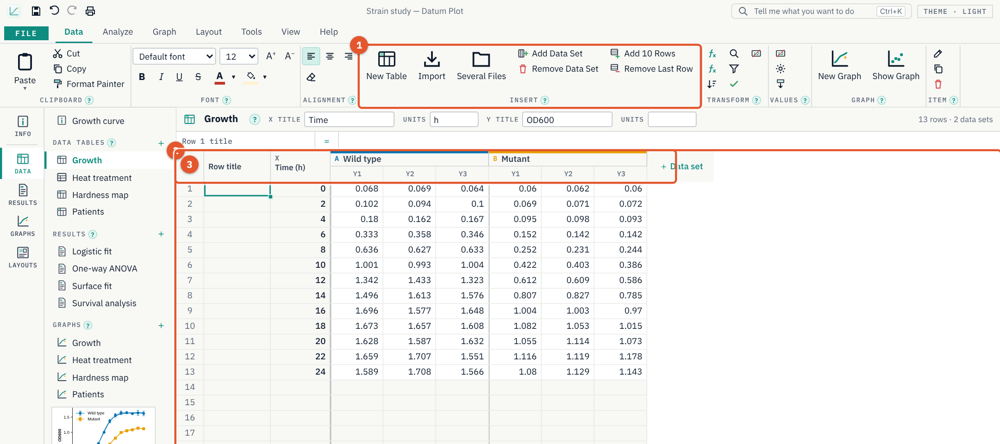

1. **Data › Insert**（数据 › 插入）。**New Table**（新建表）、**Import**（导入）、**Several Files**（多个文件）、**Add Data Set**（添加数据集）、**Remove Data Set**（删除数据集）以及行操作。
2. **表头。** X 的标题和单位，以及各数据集的标题。双击表头可以修改标题、重复值个数或数值的输入方式。
3. **单元格。** 输入数值后按 [[Enter]]。可以与 Excel 互相复制粘贴（[[Ctrl+C]]、[[Ctrl+V]]）；[[Ctrl+D]] 向下填充。

数据集可以按重复值输入（每个数值占一列），也可以按论文或其他软件给出的 **mean, SD and N**（均值、标准差和样本量 N）或 **mean, SEM and N**（均值、标准误和样本量 N）输入：在数据集的表头中选择。

如果想让某个数值不参与图表和分析，但又不删除它，选中它后按 [[Ctrl+E]]（**Exclude / Include**，排除 / 包含）。被排除的数值显示为蓝色斜体并带删除线。

### 公式与变换

- **Data › Column Formula**（数据 › 列公式）根据其他列计算填充一列，例如 `(B - A) / A * 100`。数据变化时该列会自动更新。
- **Data › Transform**（数据 › 变换）生成一张由变换后数值组成的新表：取对数、1/X、°C 换算为 K、扣除基线、归一化。
- **Data › Check Data**（数据 › 检查数据）查找输入错误、缺失值以及对数坐标轴无法显示的数值。

### 导入

**Data › Import**（数据 › 导入，或 **File › Import**）可读取 CSV、TXT 和 TSV 文件、Excel 工作簿（.xlsx）以及 .pzfx 项目。预览会显示各列将被如何读取；选择表头所在行和重复值设置后点击 **Import**（导入）。**Data › Several Files**（数据 › 多个文件）可一次导入多次测量：如果各文件的 X 值相同，每个文件作为一个数据集放在同一张表中，否则每个文件生成一张表。软件能识别酶标仪的板布局（96 孔和 384 孔）。

## 分析与结果

### 选择分析方法

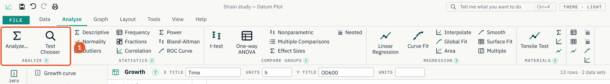

1. **Analyze… 和 Test Chooser**（分析… 和检验选择器）。**Analyze…** 列出全部分析方法；**Test Chooser** 会就您的数据提出三个问题，然后推荐合适的检验方法。

Analyze 选项卡的其他组可以直接启动一项分析：**Statistics**（统计）、**Compare Groups**（组间比较）、**Regression**（回归）、**Materials**（材料）等。

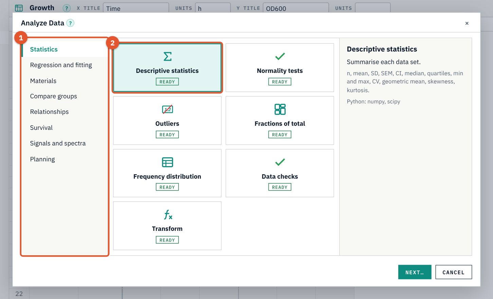

1. **分组。** 统计、回归与拟合、材料、组间比较、相关关系、生存分析、信号与光谱。
2. **分析方法。** 单击某一项可阅读它的作用以及所用的 Python 库；**Next…**（下一步…）会询问要包括哪些数据集以及分析选项。

### 结果表

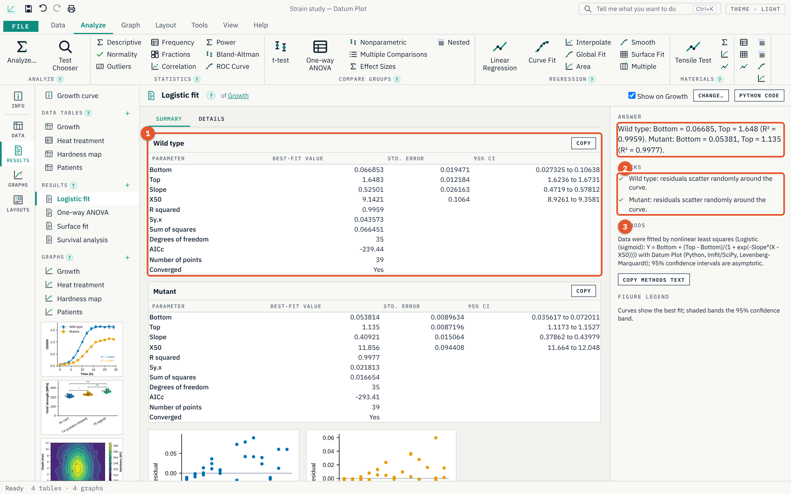

1. **结果表格。** 各项数值，附有标准误和 95% 置信区间。**Copy**（复制）把表格复制出来，可粘贴到 Excel 或 Word。
2. **结论。** 用通俗的语言说明分析发现了什么。
3. **Checks**（检查）。各项前提假设是否成立（例如残差是否随机分布），用对勾或警告标出。

下面是可直接粘贴到论文中的 **Methods**（方法）文字（**Copy methods text**，复制方法文字）和图注。**Change…**（更改…）重新打开分析选项；**Python code**（Python 代码）显示得出该结果的 Python 代码，方便您在其他地方重复计算。勾选 **Show on graph**（显示在图上）可以在图表上画出拟合曲线或显著性星号。

> **提示：** 不确定某个数字的含义？点击它旁边的 **?**，或打开 **Help › Glossary**（帮助 › 术语表）。

### Datum Plot 能做哪些分析

- **统计：** 描述性统计、正态性检验、离群值、频数分布、占总量的比例。
- **组间比较：** t 检验（非配对、Welch、配对）、非参数检验、带多重比较的单因素和双因素方差分析、嵌套 t 检验和嵌套方差分析、效应量、检验效能。
- **相关关系：** 相关分析、Bland-Altman 方法比较、ROC 曲线、列联表（卡方检验、Fisher 精确检验、相对危险度、比值比）。
- **回归与拟合：** 线性回归、使用模型库或自定义方程的曲线拟合、全局拟合与模型比较、插值、曲线下面积、平滑、多元回归、logistic 回归和 Poisson 回归、主成分分析与聚类、曲面拟合。
- **生存分析：** Kaplan-Meier 曲线、log-rank 检验和风险比。
- **信号与光谱：** 寻峰，Gaussian、Lorentzian 和 Voigt 峰拟合，傅里叶频谱和滤波。
- **材料：** 拉伸试验、Weibull 强度分析、Arrhenius 活化能、S–N 疲劳曲线、DSC 和 TGA 热分析。

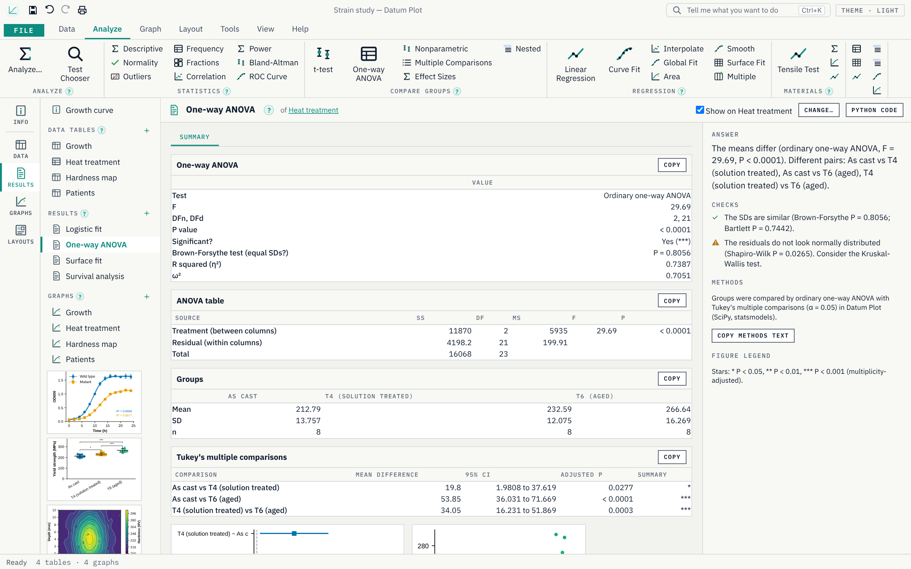

## 图表

### Graph 选项卡

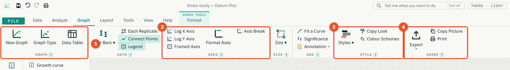

1. **Graph**（图表）。**New Graph**（新建图表）、**Graph Type**（图表类型：散点图、柱状图、箱线图、小提琴图、前后对比图、折线图等）和 **Data Table**（数据表，返回数据）。
2. **Axes**（坐标轴）。对数坐标轴、带边框的坐标轴、**Format Axes**（设置坐标轴格式）和 **Axis Break**（坐标轴断开）。
3. **Style**（样式）。适用于期刊和演示文稿的现成 **Styles**（样式），**Copy Look**（复制外观）到其他图表，以及 **Colour Schemes**（配色方案，包括色盲友好的配色）。
4. **Share**（共享）。**Export**（导出）、**Copy Picture**（复制为图片，可直接粘贴到 Word 或 PowerPoint）和 **Print**（打印）。

其他组用于设置 **Error Bars**（误差线）、显示 **Each Replicate**（每个重复值）、连接数据点、显示图例、设置 **Size**（尺寸），以及添加拟合曲线、显著性星号或注释。

### 设置图表格式

双击图表的任何部分（坐标轴、数据集、标题）即可设置其格式，也可以使用 **Graph › Format Axes**（图表 › 设置坐标轴格式）。

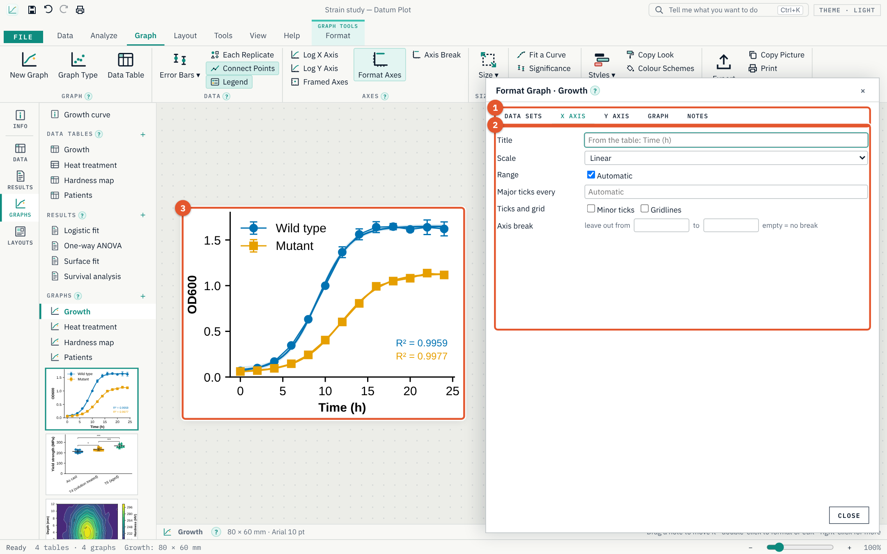

1. **页面。** **Data Sets**（数据集：符号、颜色、线条、误差线、右侧 Y 轴）、**X Axis**（X 轴）、**Y Axis**（Y 轴）、**Graph**（图表：尺寸和字体）以及注释。
2. **设置项。** 修改立即生效。
3. **图表**在您操作时始终可见。

### 在图表上操作

- 鼠标悬停在数据点上可查看其数值。
- 拖动注释可移动它；双击可编辑。
- 在数据点上点右键可将其排除。
- **Zoom to a Box**（框选缩放）、**Pan**（平移）和 **Statistics of a Region**（区域统计）在图表的右键菜单中；按住 [[Ctrl]] 并滚动鼠标滚轮可缩放视图。

### 适用于各类数据的图表

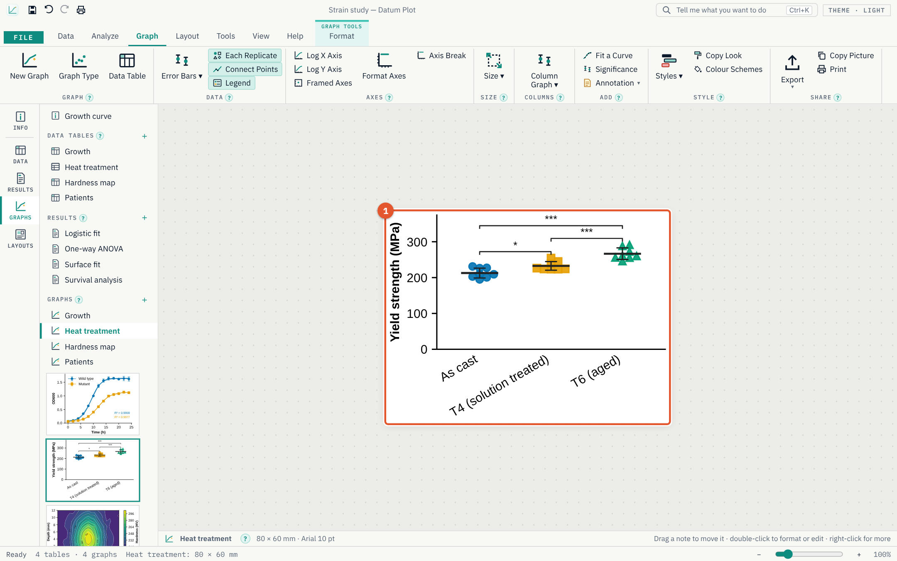

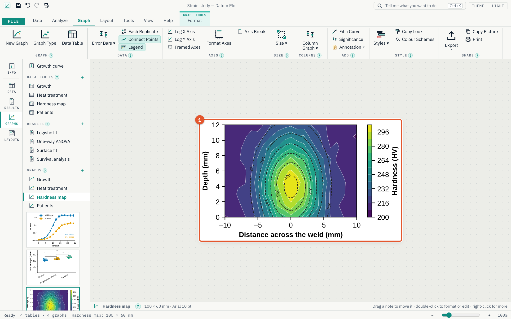

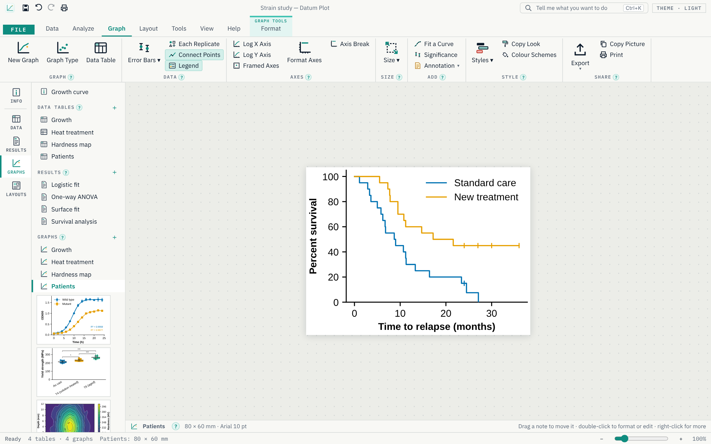

XY 图表也可以绘制成极坐标图（**Format Graph › Graph › Polar**，设置图表格式 › 图表 › 极坐标）；矩阵表可以绘制成等高线图、热图、三维曲面图或线框图。

## 版面与导出

### 页面版面

版面把多张图表和文字排在一页上：用于期刊的多面板插图、海报或幻灯片。

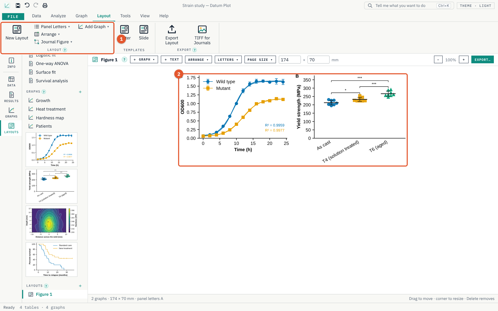

1. **Layout**（版面）。**New Layout**（新建版面）、**Panel Letters**（面板字母：A、a、(a)）、**Arrange**（排列：对齐面板并调整大小）、**Journal Figure**（期刊插图：期刊的单栏或双栏宽度）和 **Add Graph**（添加图表）。
2. **页面。** 拖动面板可移动它；拖动角点可调整大小。在面板上点右键可看到更多选项。

**Templates**（模板）组用于新建 **Poster**（海报）或 **Slide**（幻灯片）。**Export**（导出）组用于保存页面。

### 导出

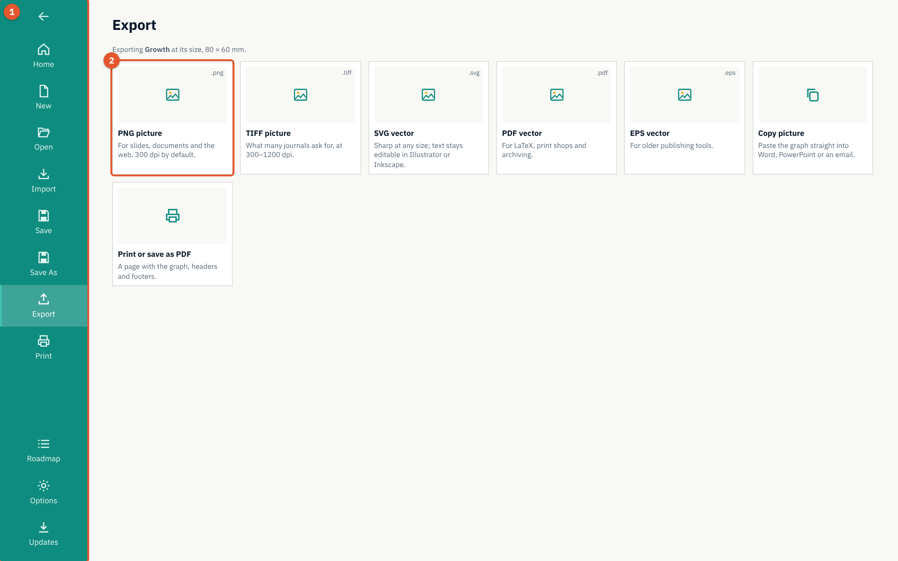

1. **File › Export**（文件 › 导出）导出当前打开的图表。
2. **格式。** **PNG** 适用于幻灯片和网页；**TIFF**（300–1200 dpi，需要时可用 CMYK）适用于期刊；**SVG**、**PDF** 和 **EPS** 是矢量格式，任意缩放都保持清晰。**Copy picture**（复制为图片）把图表放到剪贴板上。

**Tools**（工具）下还有其他共享方式：

- **Export All Graphs**（导出全部图表），一次完成。
- **Excel Workbook**（Excel 工作簿）：所有表格和结果保存在一个 .xlsx 文件中。
- **PowerPoint**（演示文稿）：每张图表单独一张幻灯片（.pptx）。
- **Word Report**（Word 报告）：项目信息、每张图表及其图注、每个结果以及方法文字（.docx）。

### 打印

**File › Print**（文件 › 打印）打印带页眉和页脚的图表，或将其保存为 PDF。

## Python 控制台与自动化

### Python 控制台

Python 控制台可以在项目数据上运行您自己编写的 Python 代码。

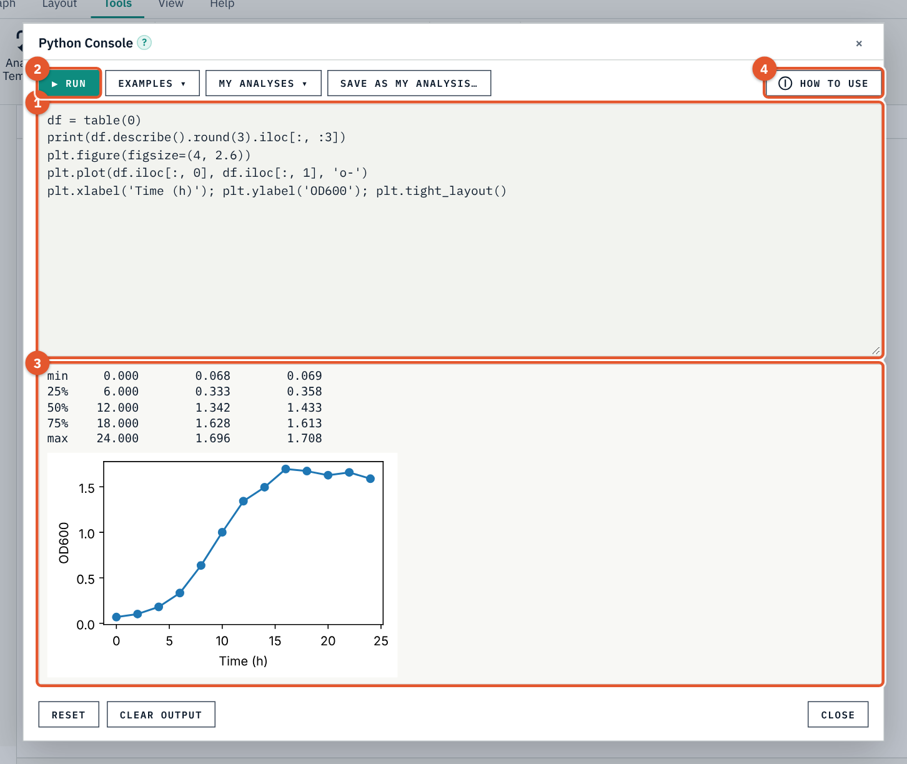

1. **代码。** 在这里编写 Python 代码。您的表格已作为 pandas DataFrame 准备好：`tables` 列出全部表格，`table(0)` 是第一张表，`tables['Name']` 按名称取出一张表。
2. **Run**（运行，或 [[Ctrl+Enter]]）。
3. **输出。** 您打印的内容、最后一行的值，以及用 `plt` 绘制的任何图形。
4. **How to use**（使用方法）。控制台内的简短说明；**Examples**（示例）会填入可以运行的代码，供您在此基础上修改。

可以直接使用：`np`（numpy）、`pd`（pandas）、`stats`（scipy.stats）、`scipy` 和 `plt`（matplotlib）。`new_table('Name', data)` 向项目添加一张表；`result('Analysis name')` 给出某项分析的数值。变量在多次运行之间保留，直到您按下 **Reset**（重置）。

> **注意：** 控制台以您的权限运行您编写的代码，和任何 Python 脚本一样。项目文件中从不包含代码：打开别人发来的项目不会运行任何东西。

### 自动化

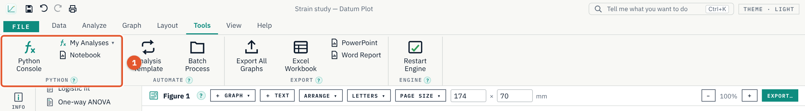

1. **Python**。**Python Console**（Python 控制台）、**My Analyses**（我的分析，即用 **Save As My Analysis**（另存为我的分析）保存的代码）和 **Notebook**（笔记本，把项目作为 Jupyter 笔记本）。

- **Analysis Template**（分析模板）把一张表的分析（连同选项）及其图表外观套用到其他表上。
- **Batch Process**（批处理）以一张表为模板，处理许多文件：每个文件生成一张表，带有相同的分析和一张图表，所有结论汇总列在一起。

## 文件

- **Save**（保存，[[Ctrl+S]]）把整个项目保存在一个 `.dplot` 文件中：表格、分析、图表和版面。保存是原子操作：即使程序崩溃或磁盘已满，也不会留下写了一半的文件。
- **Open**（打开，[[Ctrl+O]]）打开 `.dplot` 文件；也可以在 Windows 中双击该文件打开。
- Datum Plot 每隔几分钟保存一份恢复副本（**File › Options**，文件 › 选项）。如果程序意外关闭，下次启动时会提示恢复您的工作。
- **Undo**（撤销）和 **Redo**（重做）（[[Ctrl+Z]]、[[Ctrl+Y]]）可以逐步回退或重做每一次修改。

## 软件内帮助

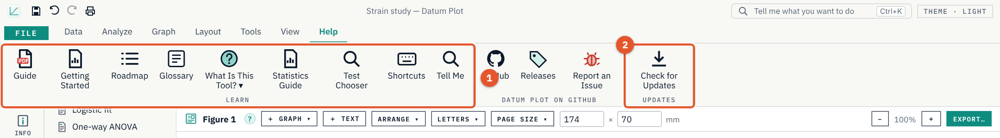

1. **Learn**（学习）。**Guide**（指南，即本指南）、**Getting Started**（入门）、**Roadmap**（路线图：Datum Plot 将要实现的功能及时间）、**Glossary**（术语表）、**What Is This Tool?**（这是什么工具？）、**Statistics Guide**（统计指南）、**Test Chooser**（检验选择器）、**Shortcuts**（快捷键）和 **Tell Me**（告诉我）。
2. **Updates**（更新）。**Check for Updates**（检查更新）。

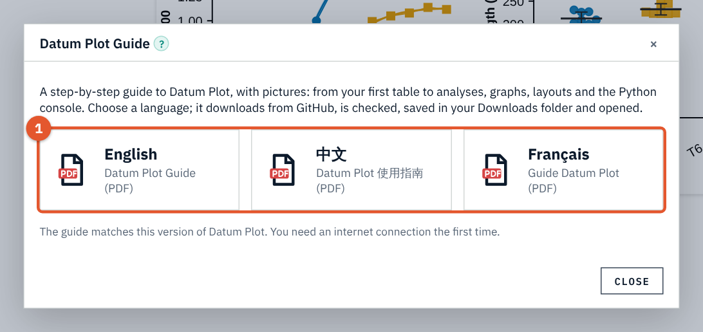

1. **语言。** English, 中文 or Français。指南从 GitHub 下载，经过校验和核对后保存到您的“下载”文件夹并自动打开。

## 如何选择检验方法

| 您的问题 | 您的数据 | 分析方法 |
|---|---|---|
| 两组之间有差异吗？ | 两列数值 | t 检验（不服从正态分布时用 Mann-Whitney 检验） |
| 同一批对象发生变化了吗？ | 前后测量值，按行配对 | 配对 t 检验（不服从正态分布时用 Wilcoxon 检验） |
| 三组或更多组之间有差异吗？ | 多列数值 | 带多重比较的单因素方差分析（不服从正态分布时用 Kruskal-Wallis 检验） |
| 两个因素有影响吗？ | 分组表 | 双因素方差分析 |
| 比例有差异吗？ | 计数 | 卡方检验或 Fisher 精确检验 |
| X 与 Y 之间是什么关系？ | XY | 线性回归或曲线拟合 |
| 两个变量是否同步变化？ | 两列数据 | 相关分析 |
| 两种方法的结果一致吗？ | 配对数值 | Bland-Altman 分析 |
| 一项检测识别某种状况的能力如何？ | 对照组和病例组的数值 | ROC 曲线 |
| 距离事件发生需要多长时间？ | 带事件和删失对象的时间 | Kaplan-Meier 法和 log-rank 检验 |

> **提示：** **Analyze › Test Chooser**（分析 › 检验选择器）会替您提出这些问题。

## 术语表

| 术语 | 含义 |
|---|---|
| **Data set**（数据集） | 表中的一组数值（一列，或一组重复值列）。 |
| **Replicate**（重复值） | 对同一对象的重复测量。 |
| **SD**（标准差） | 标准差：数值的离散程度。 |
| **SEM**（标准误） | 均值的标准误：均值估计的精确程度（SD/√n）。 |
| **95% CI**（95% 置信区间） | 95% 置信区间：以 95% 的置信度包含真实值的范围。 |
| **P value**（P 值） | 如果实际上不存在差异，观察到这么大差异的可能性有多大。 |
| **R²** | 拟合直线或曲线所能解释的变异所占的比例。 |
| **Censored**（删失） | 最后一次观察时尚未发生事件的受试对象。 |
| **Residual**（残差） | 数据点到拟合曲线的距离。 |

## 快捷键与故障排除

### 快捷键

| 按键 | 功能 |
|---|---|
| [[Ctrl+S]] / [[Ctrl+Shift+S]] | 保存 / 另存为 |
| [[Ctrl+O]] / [[Ctrl+N]] | 打开 / 新建 |
| [[Ctrl+Z]] / [[Ctrl+Y]] | 撤销 / 重做 |
| [[Ctrl+C]] / [[Ctrl+V]] | 复制 / 粘贴（可与 Excel 互通） |
| [[Ctrl+E]] | 排除或包含数值 |
| [[Ctrl+D]] | 向下填充 |
| 在图表上按 [[Ctrl+C]] | 把图表复制为图片 |
| [[Ctrl+P]] | 打印 |
| [[Ctrl+K]] | 告诉我您想要做什么 |
| [[F1]] | 全部快捷键 |

### 故障排除

- **状态栏提示图表引擎不可用。** 点击 **Tools › Restart Engine**（工具 › 重启引擎）。如果仍然失败，请从发布页面重新安装 Datum Plot；您的项目不受影响。
- **分析提示无法计算。** 提示信息会说明原因（数值太少、数值完全相同、缺少 X 值）。请修正数据，或用 **Change…**（更改…）选择其他数据集。
- **对数坐标轴上的图表没有显示数据点。** 零和负值无法在对数坐标轴上绘制；**Data › Check Data**（数据 › 检查数据）可以找出这些数值。
- **出现其他错误。** 该步操作会被拒绝，您的项目保持原样；详细信息记录在软件数据文件夹中的 `crash.log` 里。请通过 **Help › Report an Issue**（帮助 › 报告问题）向我们反馈。
